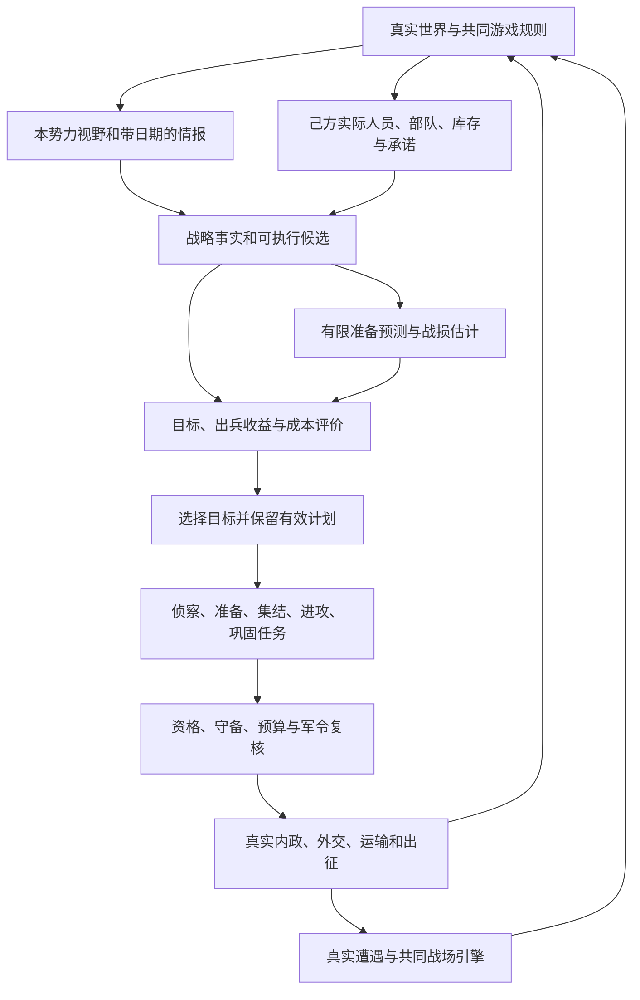

# 当前 AI 架构、输入输出与建模评价方法

核对日期：2026-10-20。本文记录当前程序实际运行的 AI，不把后续方案写成已实现能力。当前战略存档版本63、势力 AI 结构16、战略目标结构13；战斗规则版本由 combat-rules.mjs 定义。当前统一目标的机制回归与自然执行记录见 [AI互战行为与决策审计](AI互战行为与决策审计.md)。

本文中的“建模”指把真实状态转成兵力、预算、需求、任务、候选与可行性约束；“评价”指候选动作的内部评分。“验证 AI 水平”另指通过真实模拟测量执行、战果和代价，不能用内部评分高低代替。

## 1. AI 在游戏流程中的位置

普通全国模式由势力控制器统筹长期目标，城市与武将执行具体事务，军团执行真实军令，战场使用共同自动行动引擎。玩家势力仍可使用自动内政、选将推荐和委托战场；全 AI 观战通过同一控制器管理所有势力。



调用时机以 [strategic-campaign.mjs](../strategic-campaign.mjs) 为准：

- 新旬开始：`beginExecution` 先建立本旬经济结算状态，再运行整军与势力计划、外交委任、内政选事。新的军事承诺在新内政事务开办前形成。
- 每日开始：`prepareDay` 先处理外交生效、俘虏、实际供给和视野，再调用势力 AI，之后军团与运输人员实际移动。人员、侦察和视野随后继续核对。
- 势力 AI 每日最多运行一次；完整目标评审和交给目标算法的视野、情报、资源输入只在每旬初刷新一次。旬内推进已有计划、紧急守备、补给与运输，实际执行继续按当日合法观察检查安全，准备资源就绪不提前重选目标。整军投资每旬一次，外交负责人通常每10天重评。
- 接敌后：建立真实战场，AI 选择首发和部署；战中每个时间步执行补位、移动、普攻和自动战法，军略在当步行动结束后检查。

性能实现保留共同规则：完整战略输入按旬建立；仅需军团或单城的查询使用同一迷雾规则的局部投影。一次只读选事、武将推荐或同城候选评分可临时共用粮道与供给预算，道路搜索保持原有最短路与同值择序。查询作用域结束即丢弃，任职、装运、支付、出兵、行军和每日供给结算后的下一次查询重新读取实际状态，不把旧输入当作执行许可。真实粮源、库存、道路拦截、180补给距离、运力及围城营地终点规则均保持不变。

strategicCityBudget 在进入同步只读作用域后才解析默认供给来源及预测，使工资、储粮和部队供给需求复用同一次粮道测量；物流来源候选扫描也只在读阶段共享，筛选结束即释放，实际下令后不延用。自然存档的逐日完整状态、随机状态与战果须在优化前后序列化一致，局部耗时测量不外推设备帧率或全部长局。

没有发生状态变化的一批物流城市检查可以共用各城预算结果；每次调用共同运令处理器前一律丢弃，包含可能准备后拒绝的请求。后续城市在新的库存、人员与军令承诺下重算，不跨越真实下令复用预算。

**模式边界：**有 `scenarioId` 的全国模式使用本文的势力规划。无全国剧本的旧小地图原型仍由 `enemyOrders` 按道路路径段数选择最近玩家城市进攻，没有完整势力目标、准备预测和多城协同。独立战役只使用战场层，不运行全国内政、侦察、运输或君主战略。

## 2. 环节、输入、输出与方法总览

| 环节 / 入口 | 主要输入 | 输出与作用对象 | 建模和评价方法 |
| --- | --- | --- | --- |
| 势力目标：`createPlan / chooseFactionStrategy` | 己方城市预算、合法敌情、邻接道路、君主特点、旧目标与计划 | 周边势力进攻/防守/和平意向；攻占、保境、和平、恢复或发展目标 | 有限候选生成＋Utility 评分＋切换门槛＋既有进攻承诺 |
| 出兵研判：`offensiveFacts / evaluateOffensive` | 实际编组、行程、攻城输出、目标报告、来源城守备与人员 | 战损、粮耗、补兵金、收益成本、接受或拒绝原因 | 启发式能力模型与成本收益评价；资格和资源有独立否决权 |
| 准备预测：`forecastStrategicPreparation` | 各来源城库存、收入费用、在办运营、已装载运输、逐城需求 | 两旬内是否可准备、预计日期与原因 | 有限逐日资源前推，不运行真实战斗 |
| 攻城任务：`progressPlan / updateCaptureTasks` | 保存计划、真实人员位置、军令、粮草、情报和战果 | 集结/出征军令、任务状态、取消或巩固结果 | 固定攻城任务模板＋阶段状态机；按实际效果推进 |
| 侦察：`planStrategicScouting` | 主攻目标、报告日期、真实道路、合法负责人 | 派遣、保持或召回侦察任务 | 情报缺口优先级＋路程排序＋人员和轮换硬约束 |
| 守备/增援/护路：`emergencyOrders / planStrategicSupport` | 可见来袭、战场兵力、粮路、在途援军、到达时限 | 真正出兵、补充支持任务或沿路回城 | 需求缺口模型＋到达可行性＋近源贪心选兵 |
| 经济/运输/调任：`manageStrategicEconomy / logistics / personnel` | 城市预算、计划需求、科技、人员、仓储和道路安全 | 合法整补、装备、运输、人才调任命令 | 预算底线、缺口排序、真实路程与任务推荐 |
| 内政委任/选事：`prepareEnemyDomestic / beginDomesticTurn` | 本城六方向需求、人员、设施、冷却、事务和额度 | 太守与方向任职；具体事务或付费提案 | 共用选人评分；事务规则评分＋高分池加权随机选择 |
| 人才招揽：`talentCandidates / talentEligibility` | 人才线索、接洽进度、求仕意愿、资格和并行名额 | 可接洽对象、持续项目与实际入仕结果 | 明确资格门槛＋进度/质量排序；求仕规则见第7节 |
| 外交：`diplomaticAIPlan / evaluateDiplomaticProposal` | 君主城可用库存、敌情、条约、真实人员和整组条款 | 委任、拟案、反报价、AI 本方批准/拒绝 | 需求与机会成本评分＋条款利益估值＋信用折价 |
| 首发/补位/布阵：`rankEnemyReserves / planEnemyArmy` | 已抵达部队、当前能力、合法敌军、地形和已有在场效果 | 首发/补位人选和合法格位 | 当前分工缺口评分＋逐队格位启发式 |
| 战中行动：`pickTarget / moveUnit / readyTactic` | 射程、ZOC、占位、目标状态、固定战法、战意和冷却 | 合法目标、路线、普攻或首个可用战法 | 固定资格与优先规则＋局部评分＋六角网格寻路 |
| 军略：`chooseEnemyCommand / chooseStratagemPoint` | 本方持有军略、真实来源、充能、冷却、次数和有效目标 | 首个满足固定条件的军略；范围落点 | 固定触发顺序；落点仅比较有效目标队数 |
| 宝物：`manageTreasuresAI` | 己方实际宝物、合法受领者、兵种与已有羁绊等级 | 授予/装备，未随军人员跨城分配立即生效；收回城库须实际返城 | 适用资格过滤＋有现役者优先＋稳定 ID 排序 |

以上不是一个统一最优化器。势力战略的五项算法已可替换；内政、外交、选人、支持任务和战场控制仍是各自模块里的现有规则。

## 3. 战争迷雾、情报更新与算法输入

### 3.1 已接入的军事观察边界

[strategic-vision.mjs](../strategic-vision.mjs) 提供 `cityIntelligence`、`observedArmies` 和 `intelligenceWorld`。地形、城名和道路已探索；外方城市使用当前可见数据或最近带日期的报告。未观察的城市资源未知，军事估计使用规则中的保守守备/城门假设，不把未知视为已知空城。

视野外城市易主不会自动更新本方报告。外军只以可见观察进入军事判断，观察投影清空后续 `route`、最终 `target`、粮路和具体任务，只保留当前位置及可观察的当前路段。己方真实信息与对方报告分开读取。

[strategic-context.mjs](../strategic-context.mjs) 再把观察转成不带世界状态引用的值：

| 数据 | 关键字段 | 含义 |
| --- | --- | --- |
| `ownCities[]` | `gold/grain/manpower/troops/wounded`；`income/costs/reserve/shortages/daysSupply` | 己方实际库存、未来一旬预算、现役与伤兵 |
| 预测附加字段 | `operations/incoming/workLimit/workRemaining/oneTimeGold/grainCapacity` | 已在办运营的公开预期、真实在途货物、共享办理额度及单次费用 |
| `reports[]` | `id/owner/kind/known/visible/observedDay/power/gateHp/commerce/farm/grain` | 边境城市已知程度与报告日期；未知量可为 `null` |
| `enemies[]` | `id/faction/location/next/power/troops` | 已观察敌军及当前路段终点，不是秘密最终军令 |
| 评审辅助 | `neighbors/hostile/militarySignature/critical` | 已知边境势力、权威敌对关系、观察变化和己方供给告急 |
| 全国方向 | `territory.cities/edges` | 公开城市、省域、道路与合法归属报告；本方领地真实，外方仍使用带日期的已有情报 |

算法回调输入经结构化克隆和递归冻结，不含 `s`、随机种子、预先保存的成败抽签或外方秘密军令。注册模块仍是可信 JavaScript 程序；该接口隔离不是安全沙箱。

### 3.2 更新怎样影响决定

完整评审只在每旬初由 `lastReviewTurn !== s.turn` 触发。旬内新情报、兵力变化和准备资源到位不提前重选目标；已有计划、实际出兵、供给和紧急守备仍逐日复核，可以因优势消失、守备告急或断供撤销军令。`policy.strategy.updatedDay` 是评审发生日，日末审计观察到的日期可能是次日。

攻击候选对旧情报再扣不确定性：未知报告扣20分；已知报告超过3天的部分每天扣2分、最多20分。有可行侦察任务时，未知或满3天的旧目标先等待更新；没有可用负责人时才使用保守估计。

侦察候选分数为：

```text
优先级 = 主攻目标200或普通边境80
       + 未知80，或 min(80, 情报年龄天数 × 20)
```

同分比较实际道路距离，再比较负责人智力，最后按 ID 稳定排序。最多两项，不重复目标；负责人留在城内、实际斥候每天105行程点。保留每城至少一名实际可办内政人员，优先空闲人手，仅必要时释放尚未开始的可选方向任职。

已在途斥候不为评分波动反复改派。普通目标需取得报告至少2天且新目标高至少40分才轮换；主攻目标可在已有报告后提前轮换，仍需满足优先级差和合法派遣条件。报告、随机点亮期限和实际路程保存，读档不重抽。来源见 [strategic-scouting-ai.mjs](../strategic-scouting-ai.mjs)、[侦察参数](../data/design/strategic-scouting-rules.mjs)与[战争迷雾专题](战争迷雾与武将侦察.md)。

### 3.3 人才劝说的观察与真实接洽

玩家与AI只从当前可见邻城中的实际可观察人员提出劝说邀请；旧城市情报不代表人物仍在原处。候选评分使用邀请方真实名册、公开人物能力与关系，不读取对方精确忠诚、隐藏人员规模、用人需求或秘密军令。双方预览统一采用85忠诚的保守先验，情报投影只保留本方忠诚。

邀请不代表对方愿意改仕。负责人按实际道路付费赴访，完成接洽及签约时由 `talentEligibility` 复核真实忠诚、意愿、任职和归属；拒绝不退已付行资、不产生进度，并保存30日冷却。后台不每日轮询隐藏忠诚来恢复项目。在野招揽继续使用 `talent.knowledge` 的位置确认条件。边界、双边一致性、真实赴访与保存续行由 `tests/talent-intelligence.test.mjs` 验证。

## 4. 势力战略怎样建模和评价

### 4.1 候选与君主特点

[strategic-ai.mjs](../strategic-ai.mjs) 的 `createPlan` 先枚举己方未围城城市及邻接可攻目标，按当前目标、已知空城、真实道路成本、商业等级、ID 排序，最多检查32组“集结城＋目标”，找到8项可准备的进攻候选后停止。被守备等硬条件拒绝的前几组不会直接耗尽8项候选额度。每组在满足最低兵力优势后最多评估3种增量编组。

来源城仅提供可实际出征、伤兵比例符合要求的部队，保留经济负责人和守备；前、中、后期在实际容量支持下分别纳入1、2、3战略回合范围的来源。优先空闲武将，再比较路程和共用出征推荐。更大编组可能解决反攻风险，也可能因补给和人员代价被拒绝。这是有限枚举与贪心编组，没有搜索所有编组、目标顺序或外交组合。

当前库存不足不在准备预测前直接剔除候选。钱粮兵源按来源城分别提出需求，使用两旬预测判断能否筹备。守备不足时，只有安全道路上可真实调来的后方现役与已有在途部队足以补齐缺口和预计进攻需求，才生成含 `defensePower` 的筹备目标。每日通过共用调任命令运送实际部队，保留来源守备、经济人员和太守；在途及等待军令只用于避免重复派人，不作为目的城已经到位的守备。到达后等下一旬重评。前线可按实际金、技术和合适的出征人员先购置器械，不要求已经建立进攻计划。尚缺补兵预算的目标也等下一旬重评，不把未来招募或未装运库存当作就绪资源。

每次评审另保存最多32条候选准入解释：集结城、目标、守备/携粮/侦察/预算/价值/可用编组阶段、具体原因及实际队数兵数。解释不修改候选资格或结果，也不意味着已搜索后续编制和训练方案。

`factionStrategicProfile` 按君主性格区分谨慎、均衡、进取；统率与智力的加权值形成研判能力，政治影响内政机会成本权重：

```text
judgment = 0.5 × 统率 + 0.5 × 智力
errorBound = (1 - judgment / 100) × 0.2
developmentWeight = 0.75 + 政治 / 100
敌力估计 = 合法观测敌力 × (1 + 稳定有界误差)
```

误差由君主 ID 与目标 ID 的稳定哈希生成，不每日重抽、不消费战斗随机数。研判70时额外偏差最多±6%，90时最多±2%；这只限制君主额外偏差，不是模型总误差上限。自己的库存、路线与驻地仍精确复核。

AI结构17另有君主战争风险偏好：性格1／2／3／4基础概率12%／18%／35%／65%，按统智和政治修正；己方超过3回合未实际交战，每回合加2.5个百分点、最多15个百分点。前20回合乘0.35，最终限制5%至85%。每战略回合抽一次，存入势力、评审记录及新计划的军事证据；承诺后的计划持续使用旧偏好。该随机源只表示选择，不共享或预测战斗与事件随机状态，不随查询、每日推进或读档重抽。

愿冒险且预计战损不超过55%、实际整补可承担时，谨慎／均衡／进取最多减优势要求0.2／0.35／0.5，最低1.15／1.05／1.0，并分别加10／24／40点目标意愿。`rawScore` 保留原收益成本评分，最终候选分为 `rawScore + valueBonus`；增加的是君主主观意愿，收益、成本、部队能力及实际结算不变。规则与状态见 [strategic-temperament.mjs](../strategic-temperament.mjs)及战略规划表的temperament。下表记录常规风格基准，冒险修正另计。

| 风格 | 攻守优势要求 | 出兵最低收益 | 周边守备参考比例 | 筹备/交战期限 |
| --- | --- | --- | --- | --- |
| 进取 | 1.50 | 10 | 0.50 | 30天 |
| 均衡 | 1.70 | 25 | 0.55 | 40天 |
| 谨慎 | 1.90 | 40 | 0.65 | 45天 |

上述是决策参数，不给任何一方增加资源或战斗属性。正式值见 [economy-rules.mjs 的 ai.offensive](../data/design/economy-rules.mjs)。

### 4.2 战力、行程与攻城时间

战略能力使用双方共用的静态评估 [strategic-combat-assessment.mjs](../strategic-combat-assessment.mjs)，不创建战场、选择部署、移动单位或逐回合推演。规则123的 `static-v2-no-bonds` 模型按剔除羁绊收益后的攻击间隔、攻击、防御、军纪和任命加成计算，忽略双方羁绊点数、档位、组合、入场收益及属性增量；实际战斗仍正常结算羁绊和特性。固定战法按当前威力、战意门槛、冷却和共用限次归入物理输出、谋略输出、救治／护盾及控制预算，不再只按战法数量加分。普通效果的有界权重与64回合效果预算见正式 [战略规划参数](../data/design/strategic-planning-rules.mjs)，这个预算窗口只用于一次代数计算。

```text
output = Σ[(归一化普攻输出 + 可用战法输出) × 克制 × 地形 × 控制收益 × 上场权重]
durability = Σ[现役HP × 加权物理／谋略承伤能力 × 救治护盾收益 × 上场权重]
fieldPower = sqrt(output × 100 × durability)
             × (0.7 + 士气/250) × (1 - min(0.4, 饥饿 × 0.1))
```

双方都按观察到的对手兵种组成计入共同克制系数1.28／0.84；地形是公开的实际战场类别。默认六队同时上场，合法任命可增加第七队，更多真实后备按70%计入。战法控制与救治护盾收益分别封顶25%和30%，不把所有条件效果当作必然生效。出征与守备共用同一评分；选择出征部队后重新测量实际留守阵容，不能从整体战力中简单扣除单队评分。尚未观测的临时守军使用有界普通兵先验，不虚构隐藏名将或战法。

行程共用真实兵种、指挥、士气、道路和逐段行军算法。城防估计计入观察到的驻城部队、可见驻守军团和守备兵，以及依据报告金、预备兵、本旬额度与合法兵种单价估计的临时动员。未观测在城武将人数时，只估计最多一支默认目标兵力的可能守军，不读取隐藏人事。既无现役、也无可动员或及时到达兵力的已知空城不计城门战力，抵达按共同规则直接占领。

持续攻城输出只取前六队的基础攻城伤害，按攻击间隔与每日战斗步数折算，不假定所有爆发战法持续可用。已知有守军时：

```text
siegeDays = max(2, ceil(城门耐久 / 每日持续攻城输出))
空城 siegeDays = 0
duration = 最长集结天数 + 2 × 单程进攻天数 + siegeDays + 2
```

攻城输出按已经配备的器械形态读取共同属性。携粮不足覆盖全程时，再检查实际己方粮仓、当地口粮预留、既有军团供给、道路吞吐量和路线各段；攻城营地只作为可供给端点，不能作为已经占领的粮仓。无安全持续补给则拒绝，不用虚假工期掩盖缺粮，不计未来收获、战利品或尚未装运的粮车。

目标援军按最长集结加进攻行程，再加4至8天预计交战窗口检查实际可达性。观察到正在朝目标行进的军团完整计入；可能从城市出发的现役最多取一半，另留一天响应，可能改派的野战军团取75%。正在其它战场交战或迟到者不作为及时援军。同势力救援汇总；同一部队不重复算入占后反攻。中立目标另按接触前后两天检查可见的敌对争夺兵力，独立争夺势力取最强一方。报告每旧一天增加4%风险余量，上限30%；只放大估计，不读取外方未来收入、秘密军令或种子。

本城守备按下一次十日评审的可达威胁判断，潜在敌城出兵保留至少一半驻军，已来袭军团完整计入。己方实际驻城军团可补足守备，在途援军和承诺不能提前补足。占后反攻逐势力汇总取最大值，不将独立敌对势力合成联军。基础优势1.5／1.7／1.9结合真实库存及后续补兵能力调整，见下节；预算和实际补给不足仍否决。军情改变后每日复核使用同一综合标准，可取消并通过真实道路收兵，旬内不另选新目标。

### 4.3 默认战损预测与出兵评价

`battlePredictor=attrition-v3` 使用平方消耗的闭式近似，输出为估计值：

```text
ratio = defense / max(1, fieldPower)
lossFraction = defense == 0 ? 0 : min(0.8, 1 - sqrt(max(0, 1 - ratio²)))
estimatedLosses = ceil(men × lossFraction)
consumedGrain = 每日军粮 × (2 × 单程进攻天数 + siegeDays + 2) + 集结耗粮
replacementGold = ceil(按实际返城整补城补兵单价加权的总兵数 × estimatedLosses / men)
militaryGold = ceil(men / 1000 × 规则维持金 × duration / 10)
counterPower = 周边最大敌方势力的估计可用战力 × 0.5
```

当前规则维持金为0，所以 `militaryGold` 当前为0；保留字段用于读取共同经济规则，不额外收取军费。相同守方下，己方优势由两倍增加到三倍时，近似损失占比由13.4%降到5.7%；真实走位、集火、临时状态、条件羁绊、军略和延迟援军仍会造成误差。相近兵力不能当作可靠胜局，出征另受风格优势门槛与情报风险约束。离线真实对战只用于开发验证，不进入运行时评估。

`offensiveEvaluator=cost-benefit-v3`：

```text
workCost = Σ(有实际在办事务的抽调人员主属性 × min(duration, 事务剩余天数) / 100
             + 已投入事务金 / 50)
           × developmentWeight
benefit = 目标类型价值 + 商业等级 × 6 + (报告粮 > 6000 ? 15 : 0)
          + (可缓解己方边境 ? min(80, defense / 250) : 0)
          + observedStockValue + victoryValue.score
refillBurden = estimatedLosses / 80 + (replacementGold + militaryGold) / 50
depth = max(1, min(回城后补兵覆盖倍数, 2))
cost = (refillBurden + duration / 10 × 4) / depth
       + consumedGrain × 0.13 / 50 + workCost
offensiveScore = benefit - cost
```

时间负担按一战略回合4分计算；粮食评分以经济规则的每粮0.13金、每50金一分折算。行军、口粮、工期和补兵仍按真实天数与整数库存结算，评分折算不减免费用。此前每一天4分、每100粮一分会过度压低长途进攻价值。

observedStockValue 仅取不超过3天的合法城市情报，先按武力占领可保留的50%金、50%粮估算接收量，中立目标还受其规模的小额库存上限约束，再按接收金粮参考价值的35%除以100金折算，最高120分；未知、陈旧或未来日期报告为零。这是有界目标收益，不将敌仓提前加入己方携粮、预算或补兵。中立期间不积累周期产出。评分不是概率，也不能代替军事和资源准入。

`victoryValue` 从合法全国归属情报和公开道路、省域计算：占城24＋己有城市占比×24、同省己有比例×18、完成省域24、夺取对方已知最后城市35、每减少一片分散领地20、打开后续方向每项6（至多三项）、区域重点12，总收益封顶140。分解由 [strategic-victory.mjs](../strategic-victory.mjs) 计算；参数来自正式战略规划设计表。地方成本保持原算法计算，统一收益可以使眼前较昂贵的必要路径成为可行目标，但不能覆盖物理、人员、资源或安全否决。

`strategic-recovery.mjs` 逐城预测回城后20天的补兵能力，整个窗口不超过180天。初始可用金、兵源先扣工资、保留和实际承诺；稳定收入来自现有设施与留守太守，在办运营只计未随军执行人的公开预期并共用当旬额度，货物只在实际安全在途批次预计抵达日加入。每日扣本城口粮；旬末记收入与后续工资、外交行资，征补额度重置而不累积。到预计回城日才可模拟补兵，按实际兵种、装备单价扣金及兵源。本旬保留额度不重复扣后续旬额度；现有库存覆盖只比较可用金和兵源。出发后以军团真实返城据点评估，每个返城补兵城必须在窗口内补足分摊的战损，不能借用未实际调运的其他城库存。

常规基础优势为1.5／1.7／1.9。只有目标情报不超过3天且补兵可行时，按 `min(现有补兵覆盖倍数, 后续补兵覆盖倍数)` 超过一倍的余力折算，最多降低0.5，最低1.2。未知、旧情报不获得这项余力优惠；君主风险偏好另按4.1节有界处理。财政余力不增加部队攻击、防御或现役人数。来源城当下预算、真实携粮与粮道、人员、留守及占后反攻继续保留否决权。

`evaluateOffensive` 返回 `accepted/reason`、收益、成本、战损、粮耗及 `recovery`；逐城需要的金、兵数、补兵覆盖与预计日期随 `military` 证据保存和校验。所有未来数量均只是预测，最终补兵仍由共同处理器按实际到达、库存与额度执行。

持续行动先按常规要求取 `max(1.1, 当日常规出征要求 - 0.2)`，再按计划保存的君主偏好应用有限冒险容忍；下一旬单独改变偏好不会触发收兵。真实实力下降、供给失败、预计补兵无法承担仍取消并沿路回撤。出发时保留能由实际库存支撑的补兵金和固定收支缺口，保护这部分钱不被可选事务消耗。

`strategic-tempo.mjs` 直接按战略回合 s.turn 划分节奏：第1–20回合为前期，第21–60回合为中期，第61回合起为后期；10天为一回合，60天仍是前6回合。阶段上限再受逐城预算、合法现役与领地约束：少于三队可负担部队或供给危机时保留小规模行动；中期至少三队时扩大集结；后期至少四城、两座可负担城市、十队时启用协同规模。协同支持每团六队的共同进攻，以及已有主攻出发后使用独立兵源城的第二作战计划，最多两项；资源、人员、路粮仍各自复核。第二路也经过已注册的目标评价器与目标选择器；主目标保留，不能直接从候选列表挑一条进攻绕过选择策略。

新编军团携粮采用双方共用的 armySupplyCapacity，逐队取 max(900,ceil(现役/100＋伤兵/200)×30)，参数来自经济设计表。容量不等于库存；实际装载从城市仓库扣除，军团已保存的容量和携粮不在途中免费改变。9000人一队可装2700粮，解决大编组增兵后仍按900粮、只有约10天续航的限制。候选预算、军令、援军合同、路线预测及玩家确认页同步，日耗与真实粮道吞吐保持原规则。

补给预测按真实道路成本和每日行程逐日计算去程、攻城停留与返程，携粮可跨越有限无粮道路段；每一天只从当日可连接的己方粮仓取粮，共用道路与粮仓吞吐扣除既有军团需求。出发携粮从来源库存扣出，来源口粮不重复计算已出征部队；消耗超过真实携粮与可达供给则拒绝。没有未来收入、待发粮车或占领敌仓。 这只改变预测，真实供给执行、缺粮及每日回撤仍用共同规则。

前、中、后期的集结上限依次为1／2／3回合，容量不足时缩回一回合；计划期限至少覆盖实际集结、进攻行程、预计攻城及一回合执行余量，不能沿用短期个人耐心把可行远程协同挡在交战前。长期行程的评分负担与战损补兵负担一起按整补余力有界折算，最多两倍；实际粮耗、费用、当前工事、人员及守备条件不折减。自然审计支持 --turns，按这三个窗口输出每十回合战斗数、实际多军团出征和独立并行进攻，未到达的阶段保留为空。

### 4.4 目标效用与持续性

攻击候选先减去君主风格的最低收益和情报年龄罚分，得到目标候选分；尚未就绪再扣12分。其它目标：

```text
攻占效用 = 攻击候选分 - (ready ? 0 : 12)
保境效用 = 100 + 已观察敌军战力 / max(1, 己方驻城战力) × 100
和平效用 = 保境效用 - 1
恢复 / 发展效用 = 0
```

所有君主保存 `victory.objective=unify`，胜利要求占领全部城市，包括中立城；性格只改变方式。区域方向与统一进度每旬更新。己方驻城及已观察敌军均使用包含武将属性、适性、战法、装备与合法任命的同一战力模型。发展/恢复作为准备真实资源的兜底目标，尚未精细计算未来开发收益。和平候选只在没有主攻承诺、已知敌军压力超过驻城战力65%且存在敌对邻国时生成，最受压的对方优先。保境候选来自真实围城或可观察来袭。

`selector=utility-v1` 选择已按效用降序和稳定键排序的第一项。新目标优势不足20分时保留同类、同目标、同集结城的可行旧目标；已有进攻计划继续作为承诺，紧急撤销由执行层按风险处理。战略“和平”只是外交倾向，实际敌对关系须等待条约生效。

受保护邻国不生成可执行攻击；无保护的和平邻国可按宣战后的守备和反攻风险比较，仅选中实际就绪的进攻后通过共同宣战处理器改变关系。自动续约不会在没有来袭、口粮缺口或恢复需求时永久锁住区域统一方向。候选排序保留真实空城机会，攻城评分再比较统一收益和成本。`strategy.victory`、目标的 `victoryValue` 和每旬 trace 的证据均随存档保存并校验；检查不使用实时隐藏外地归属。

## 5. 可替换算法的输入输出契约

[strategic-algorithms.mjs](../strategic-algorithms.mjs) 负责注册、调用、校验与保存配置；默认纯函数在 [strategic-algorithm-defaults.mjs](../strategic-algorithm-defaults.mjs) 和 [strategic-predictors.mjs](../strategic-predictors.mjs)。

| 类型 | 当前默认 ID | 输入对象 | 精确输出 |
| --- | --- | --- | --- |
| `battlePredictor` | `attrition-v3` | `{facts, profile, rules}`，facts含静态作战特征与闭式战损占比 | `{estimatedLosses, consumedGrain, replacementGold, militaryGold, counterPower}` |
| `offensiveEvaluator` | `cost-benefit-v3` | `{facts, prediction, profile, rules}`，facts含统一收益及补兵能力分解 | `{score, benefit, cost, workCost}` |
| `preparationPredictor` | `two-turn-v2` | `{context, requirements, horizonDays}` | `{feasible, readyDay, reason}` |
| `goalEvaluator` | `utility-v1` | `{candidate, context, profile, rules}` | `{score}` |
| `selector` | `utility-v1` | `{context, profile, candidates, previousGoal, rules}` | 候选中已存在的 `id` 字符串 |

`facts` 是 `offensiveFacts` 的版本5输出，包含 `version/faction/day/target/intelligence`、攻守能力、兵数、耗粮、携粮、工期、补兵加权成本、反攻估计、逐城 `sources`、实际在办人员 `work` 及补兵预测输入 `recoveryInputs`；出兵评分收到闭式战损计算后的 `recovery`。`supply` 保存路线供给可行性与实际来源需求，`sourcesSupplied` 核对来源到集结地的供给。`sources` 保存本城可用兵源/金、剩余守备、守备需求、集结天数和经济用人错误；`intelligence` 保存已知、可见和观察日。路线查询只在一次同步评审中复用，不跨日期或实际状态变化缓存。

当前分工为“规则适配器产生候选和事实 → 预测器估计后果 → 评价器打分 → 选择器返回 ID → 执行层复核”。选择器不能另造人员或军令；同一城市的不同具体编组有不同 `candidateId`，实际计划必须绑定被选中的编组。

接口只接受同步、可克隆结果，拒绝 Promise、额外字段和非有限数字。战损为0到真实人数的安全整数，费用为非负整数，粮耗/反攻为非负有限数；准备日期必须在当前日至预测窗口内，不可行时为 `null`。

`registerStrategicAlgorithm(kind,{id,run})` 注册带版本的新 ID；筹划期通过 `setStrategicAlgorithms(s,changes)` 替换一项或多项并触发复核。配置是全局 AI 配置，不是逐君主配置；君主差异由输入 `profile` 表示。评分尺度须与最低收益、准备罚分和切换门槛一致。当前没有注册回调的超时/搜索节点预算，新增复杂算法必须自行控制计算量。

默认候选生成、硬性准入、任务模板、计划承诺和真实命令执行尚未插件化。添加新的行动类型需扩展规则适配器和共同命令，不能只在选择器中返回一个新 ID。示例与替换验证见 [strategic-algorithms.test.mjs](../tests/strategic-algorithms.test.mjs)。

## 6. 有限准备推演与可执行计划

### 6.1 两旬准备预测

`two-turn-v2` 只复制各来源城资源并逐日前推最多20天。输入 `requirements[]` 为每城 `{cityId,gold,grain,manpower}`；来源城不存在或围城立即不可行。

前推顺序为：预计到达的已装载物资 → 库容限制 → 当日平均粮耗并检查是否断粮 → 当日已在办运营的公开预期 → 库容限制 → 旬末收入和预算费用 → 检查全部城市是否达到需求。

在办运营以基础数量乘公开成功机会估计，受当前剩余和下一旬共享办理额度限制，不读取预存成败、协作抽签或意外献赠。不预测未开办事务、未装载后续批次或未确定的中转下一程。运输只计路线当前安全、未受阻且实际装载的在途物资，按剩余道路成本和真实速度估到达。

单次工作、编组、待发金运输和债务预算不每旬重复扣除；周期费用继续计算。预测没有敌方反应树、战争全过程、完整状态克隆或实际战斗调用。内政失败与运输被截会使预期失效，后续每天读取实际结果调整；`feasible=true` 不表示资源可提前支用。

### 6.2 保存的数据和任务

| 数据 | 保存位置 | 主要字段与用途 |
| --- | --- | --- |
| 势力策略 | `campaign.ai.factions[f].strategy` | `neighbors/goal/revision/updatedDay/militarySignature/critical/trace` |
| 阶段目标 | `strategy.goal` | `candidateId/kind/targetFaction/targetCity/staging/status/score/createdDay/reason/planId/requirements/forecast` |
| 作战计划 | `campaign.ai.plans[]` | `id/faction/phase/target/staging/officerIds/origins/reserves/createdDay/updatedDay/deadline/reason/tasks/intelligence` |
| 城市需求 | `campaign.ai.cities[id]` | 前线、集结、后方、恢复等角色及实际钱粮兵源需求，影响内政与运输 |
| 支持任务 | `campaign.ai.supports[]` | 护路/增援种类、目标、战场、实际人员、期限及最近需求日 |
| 真实命令 | `campaign.domestic.orders[]` 与实际军团/行旅 | 完成事务后执行的编组、出征或运输，人员和资源不得重复承诺 |

[strategic-planner.mjs](../strategic-planner.mjs) 使用固定攻城分解：

| 任务 ID | 类型 | 依赖 | 完成凭据 |
| --- | --- | --- | --- |
| `observe` | 侦察 | 无 | 已满足当前情报/侦察等待条件 |
| `supply` | 准备补给与资金 | 无 | 实际粮草、逐城金与兵源满足；已出征阶段记录准备已通过 |
| `assemble` | 集结 | 无 | 集中计划全员到齐；分城协同全员本地就绪并保存统一接敌安排；或已真实出征 |
| `assault` | 进攻 | 前三项 | 目标确实归本势力 |
| `secure` | 巩固 | 进攻 | 不再围城、口粮、伤兵和守备满足完成条件 |

每项保存 `id/kind/dependsOn/status/updatedDay/refs`，状态为 `waiting/running/done/cancelled`；引用指向真实侦察、武将、军团或待执行军令。任务记录观察实际效果，不自行扣费、生成军团或发放战果。当前是一个固定 HTN 风格模板及执行状态机，尚无通用 HTN 搜索器或多种分解方法竞争。

计划按 `prepare → assemble → attack → consolidate → complete` 推进，也可 `cancelled`。前中期最多一个主要进攻承诺，后期容量达标且已有主攻进入进攻后可选择独立第二路；占城后的巩固释放主攻槽位与原人员承诺，仍检查真实守备。目标失守、人员缺失、集结城失守、道路失效、外交保护、敌军增援、供给告急或期限超出可导致等待、撤销和真实回撤。

集中计划立项时就按集结城的真实补兵能力评估；后期多城且超过六队的联合计划保存每个军团的来源、人员、路线、行程与出发日，保留各自整补基地。统一接敌日由最长真实行程确定，近路军团留在本城等待，远路先发；最多容许两天接敌偏差，实际进入同一战场才算协同。第一批发令前逐城核对全员、工作时机、守备及实际资源，逐团经过共同出征入口支付携粮。

日常军团管理保持协同军团的既定行军方式，不自行切换急行军或轻装改变接敌时间和携粮；实际危险继续走取消与回撤流程。活动目标的来源城守备修复需求绑定对应计划，不能借用另一计划的守备请求或军事证据。

`strategicColumnTravelDays` 按各条已选道路的地形测量实际行军速度：水路使用本团实际船只，陆路使用兵种及器械速度，再应用共同任命、士气与特性规则，逐段向上取整天数。行程与真实引擎同样不把到节点后的剩余行动力带到下一段；不能以一次陆速估完整混合路线。

`forecastCoordinatedSupply` 对全体拟出征军团共用一份真实粮库余额、逐日城市发粮及道路吞吐账；扣除现有军团用粮、本城留守、待发军团等待口粮与实际装载，按保存出发偏移核对各段行程，排除敌仓与未来收入。不能分别检查每团后就把同一库存或每日360粮道路运力多次承诺。

准备缺口使用 `repairUntil` 保留原目标最多两战略回合，且不延长原计划期限。守备补充只通过真实调任，到达后才计入；经济岗位须实际替代；接近优势门槛的计划只在旬初最多补入三队合法现役，并再评估全部成本。每日可以暂停或恢复既有准备；严重威胁和协同发令后无法完成原接敌安排仍取消。每个计划保存自身最新 `military`，目标切换时不继承另一计划的旧军事证据。机制回归见 `tests/strategic-coordination.test.mjs` 及 `tests/strategic-tempo.test.mjs`，固定机制条件不能代替自然后期验收。

### 6.3 命令怎样落地

`commandUnits` 经共用推荐确定军团长、军师，再调用 [strategic-orders.mjs](../strategic-orders.mjs) 的 `requestFactionOrder`。执行器校验驻地、人员资格、编制、队数、费用、携粮和实际道路；等待内政时只保存命令，最终生效才创建大地图军团。

`expeditionTiming` 先核实实际驻城与未外出，再判断事务：救援等候会错过真实到达时限时可立即执行；近一旬有中断、尚余不超过2天或高投入工程已完成大半时倾向等候；其余长事务可因出征优先中断。发兵前仍重新检查来源城守备、经济人手与整体出兵评价，不让历史计划授权抽空刚受到威胁的城市。

### 6.4 紧急守城、护路与战场增援

`emergencyOrders` 根据已观察来袭战力与实际城防求守城缺口，扣除来得及抵达的既有军团和等待军令；仍不足时释放主攻承诺，按实际到达天数从近来源派援。等待原事务的时间计入到达约束，军令不等于援军已经到场。

[strategic-support-ai.mjs](../strategic-support-ai.mjs) 另管理最多三项支持任务：

```text
战场增援缺口 = max(0, 对方已到达战力 × 1.15 - 己方已到达战力)
护路缺口 = max(0, 可见威胁战力 × 1.20 - 节点实际己方驻军战力)
```

战场模型计存活且已确认抵达的在场/后备人员；护路目标来自己方实际粮路、真实在途或待发运输通道。先处理增援优先级200，再护路100，同类比较缺口与稳定目标键。扣除能及时抵达的既有援军后，按来源到达天数贪心选兵，检查守备、经济用人、船、装备金、本城粮和往返携粮。到达窗口最多8天，战场剩余时间更短时取更短窗口；仍无法满足则不伪造援军。

任务结束、护路连续4天无需求、人员丢失或超过30天期限时解除等待命令并沿真实道路回城；需要更大兵力时补充同一任务，避免重复派队。断供预测还会结合实际返程时间提前收兵；战场兵损过重或缺粮也可撤退。支持判断为启发式，没有全局最优的军团调度搜索。

## 7. 城市经济、内政与人才 AI

### 7.1 预算、整军、物流与人才调任

[city-budget.mjs](../city-budget.mjs) 的 `cityBudget` 是共同只读模型：未来一旬收入减去真实驻兵/外军供给、预计未开办事务、外交行资、军令编制、待发运输和债务，再扣资源预留；另检查旬末收入到账前能否维持。已付事务不再计费，在途物资不作为现存可用库存。

战略预算采用 `workPolicy:'essential'`，保留基本赚钱、产粮、救治、征集兵源等需求，尚未开办的可选工程可让位；已批准提案与真实承诺继续计算。`manageStrategicEconomy` 只在预算允许时升兵、装备、预编和补兵。升级在同兵科内按已有武将特点选择，船与器械按实际路线和目标需要配备，不搜索所有兵种组合。

`logistics` 先处理预算短缺、口粮将尽的城市，减去已有实际运输及待执行安排以避免重复，再从保留来源预算后有余量的城市找安全道路。来源按实际道路成本排序，运输人按共同速度推荐，转漕、漕运往返和接粮会合仍逐批实际装卸，不提前入库。

当不被围城的城市口粮不足3天、撑不到旬末且无及时安全粮车时，先撤销可选进攻，再在保留守备前提下将部分现役完整转回本城预备兵。原规则的缺粮、减员和解散继续生效，不能凭空补钱粮。

`personnel` 为缺少内政人的大城从有余裕的己方城市调任真实空闲、无部队/伤兵人员。评价为“目的城最好岗位推荐 × 城市方向权重 − 原岗位推荐的一半 − 路径段数×5”；只选正值且可安全调任者，实际沿路移动。

调任保存人员、目的城与拟任方向。实际到达后通过共同 `assignDomestic` 委任；原方向已有负责人时改用真实可办的空缺方向，有既存合法任职则保留。普通运输、再次调任、可选侦察和出征不抢走这项任务，保护到首个真实事务尝试完成。目的城失守、人员离队、改程或无可办岗位则解除；实际口粮告急允许共同运输处理器中断原任务救急，并记录理由。任务不提供资源、产出或额外办理额度。

### 7.2 共用选人评分

[officer-recommendation.mjs](../officer-recommendation.mjs) 的输入是 `(s, unit, taskProfile)`，输出 `{availabilityPriority,score,available,traits,reasons}`，同时用于玩家推荐与 AI。它只读、确定性，不抽签；分数只比较同类任务，不是成功率。

| 任务 | 模型 |
| --- | --- |
| 内政方向 | 读取该人的合法事务，使用与自动选事相同的高分池和权重，按事务需求、成功机会、数量/节费特性和工期折算，再参考实际协作 |
| 太守 | 政治＋真实太守收入、折扣与安抚特性 |
| 调任/运输 | 共同规则实际每日行进速度 |
| 军团任职 | 军团长统率、军师智力，再计合法任职机制；军略资格按名单 |
| 补兵 | 实际可补缺额，伤兵不作为直接补兵空位 |
| 预编/出征 | 统率×0.4＋武智较高值×0.25＋兵种适性档×8＋min(15,现役/300)＋固定战法数×2，不计羁绊点数 |

任务排序先看可用性及出征空闲优先级，再看分数和 ID；正在办事或外出者不会因评分高就跳过资格。规则123出征、编组与部队推荐不再按个人已获得羁绊点数加分，也不枚举组合凑档、保档或预测后备收益；玩家页面仍可查看实际羁绊并自行组合。

`prepareEnemyDomestic` 补任空缺太守；产出不足时优先保障农业、商业，再按“人员×方向”推荐与城市意向权重贪心填补空缺，保留在办事务。额外经济人员仍消耗真实费用并共享本城办理额度。

### 7.3 具体事务、研究与人才对象

[domestic.mjs](../domestic.mjs) 的 `actionCandidates(s,assignment)` 输出 `{key,cost,amount,recruitMode,targetId,score,chance}`。先按方向、冷却、费用、设施、唯一施工/研究槽、目标资格、容量与共享额度排除不合法动作，再评分。

代表性优先级：粮食紧缺的督耕120分，正常不足储备75分；修缮100分并可加威胁20分；治伤65分再按伤兵增加最多20分。工程、征兵、商业、人才等各有独立规则，随后叠加执行人性格、数量/成功/节费特性和协作价值；同动作失败次数每次扣12分。势力准备、恢复或守备目标将相应合法事务乘1.3优先权重。

旬开始的实际选择并非总取最高分：

```text
good = 所有 score >= 最高分 - 14 的合法候选
weight(action) = score(action) - 最高分 + 15
按 weight 使用保存的内政随机序列抽取一项
```

输出进入真实 `action`；玩家付费事务可能先形成 `proposal`，须按原案裁示再开办。成本、工期、成功/部分成果/失败、施工地点与额度均由共同执行器处理。已有工作不因每日评分重新选择。

研究优先续办已保存项目；新科技按本城合法科技树筛选。模型计入科技层级、金粮兵缺口、当前兵科适配、军事节费和可见边境威胁。不是跨城市科技树或长期科技序列搜索。

`talentCandidates` 在资格通过后评分：招揽基础70、劝说45，已积累进度最多加15、质量最多加15，较高入仕意愿的招揽再加5；已投入项目优先，占用真实并行名额。求仕意愿由 [talent-core.mjs](../talent-core.mjs) 的共同模型确定：

```text
W = clamp(50 + 0.4×(相性适合度-50) + 0.4×(君主关系-50)
          + 同僚好友参考 + 岗位供需影响 - 旧主顾虑, 0, 100)
```

`W` 是入仕意愿、不是一次事务成功率。劝说邀请的可见候选按邀请方公开估计评分，真实忠诚与对方改仕意愿在实际接洽及签约时独立复核；在野招揽沿用已确认位置线索和原有资格。冷却、实际接洽范围、身份、旧主整理期和并行项目继续校验。人才劝说的观察边界限制见第3.3节。

在野人物移动属于共同人物行为模拟：在有限可通行范围内比较目的势力意愿、同城好友、路径段数与保存随机扰动，随后逐日实际移动。这不是君主可读取的隐藏未来计划。

## 8. 外交决策与评价

[diplomacy.mjs](../diplomacy.mjs) 分三个环节：

1. `diplomaticCandidates` 根据方向、资源缺口、俘虏、已知压力、条约期限与重点势力拟定整组条款；先核验可申请的对象、路线和拟用部队。未知对方库存不是可确认承诺，接洽与签署仍须实际复核。
2. `diplomaticAIPlan` 比较合法负责人，输出 `officerId/direction/goal/target/score/reason/waitingDays`，达到门槛才委任；最多两名，已有项目不中途每日换目标。
3. `evaluateDiplomaticProposal` 在交涉完成后由各方分别评整组方案，输出 `score/benefit/cost/reason/style/judgment/approve`；AI 只批准本方，玩家批准不能由 AI 补写。

负责人分数：

```text
candidateScore = 真实需求优先级 + 战略和平偏好 - 单程出使路程天数×0.8
assignmentScore = candidateScore + 方向主属性×0.05
                  - 内政机会成本×developmentWeight - 接洽费×0.03 - 等待事务天数
```

方向主属性为交好魅力、通商政治、交涉智力。人员需真实在城且无外交冲突，另保留经济生产人员和来源城预算。

整组利益模型按入项计收益、出项计成本：金按稀缺性加权，粮按本城缺口调整价格，预备兵按缺口估值；城池计经济、城防与君主城价值，俘虏计真实赎回价值。和平计军事压力与君主倾向，并在对方军力信息足够时扣除停止优势扩张的机会成本；援军计兵力、路程、共同敌人与真实服务成本。

```text
proposalScore = round(benefit × (1 + 稳定有界研判误差)
                       × clamp(对方信用/100, 0.4, 1) - cost)
```

非负评分才倾向批准，实际资源和条款资格另行验证。未来付款有时间折价；不合适金钱对价最多两轮反报价，新版本清除旧批准。签署、金粮预留、运输、条约生效和军事履约均是实际流程。没有多方外交博弈搜索，也没有因“评价成交”直接生成物资或虚构援军。参数见 [diplomacy-rules.mjs](../data/design/diplomacy-rules.mjs)与[外交专题](外交系统设计.md)。

## 9. 战场 AI 与共同自动行动

### 9.1 首发和后备补位

[battle-ai.mjs](../battle-ai.mjs) 的 `rankEnemyReserves(b,candidates,side)` 仅比较已抵达、已确认、存活的后备；`fillSlots` 只在合法空位出现时调用。通常六队上场，合法额外名额遵循共同规则。输出是后备的择序，不重排既有在场行动数组。

模型将剔除羁绊收益后的输出、承伤与支援能力在当前己方候选池归一化：

```text
output = max(普攻威力×3/攻击间隔, 已有进攻战法类型对应的武技或谋略威力×0.9)
bulk = 当前HP × (1 + 防御/100)
基础分 = 55×归一化输出 + 20×归一化承伤 + 5×min(1,智力/100)
```

再按当前前排缺口、已有前排、支援缺口、友军伤势、可见敌军骑/前/后排兵力占比、地形及攻城需要加分，稳定同分按 ID。首发和补位不计当前及未来的羁绊收益，不搜索替补进场顺序的组合。

### 9.2 初始布阵

`planEnemyArmy` 仅在第0步、部署未锁定时摆放已选首发。前排、后排、骑兵侧翼及舰船各有偏好位置；骑兵按可见敌军分布避开枪戟密集侧，支援跟随真实核心，远程偏好高地、伏兵利用树林。布阵不为军阵标记格或其它羁绊收益评分。

双方均由 AI 控制时，`planBattleCouncilsAI` 让两方基于同一份战前状态各自提案，再通过共同任命和部署处理器执行。评审顺序不提供额外反应机会。只有一方 AI 时仍使用已有单方军议，保留玩家已提交的部署；战中补位不重布现役，不改变行动数组、资源或未抵达部队。

合法格位的基础代价为 `4×横向偏差 + 2×纵向偏差`，再加支援距离、骑兵地形阻碍、沼泽代价等，取最低代价格位并占用。是逐队贪心部署，未搜索全局站位，也不挑选羁绊人员组合。固定战法不因对手重抽或另选，配置复核只恢复共同固定配置。

### 9.3 选敌、移动与普通行动

[engine.mjs](../engine.mjs) 的 `pickTarget`、`findMoveRoute`、`moveUnit` 与 [engagement.mjs](../engagement.mjs) 同时用于双方。玩家的部队也按共同规则自动走位和攻击。

目标选择先处理可见/可攻击、嘲讽、有效集火、近战接触、特性追击与最低射程等资格；近处残血收割和合法远程目标等优先池随后决定可比较对象。普通比较取最低代价：

```text
目标代价 = 距离×距离权重 + 目标HP比例×血量权重
           + 真实绕路代价 + 建筑威胁/器械/连续攻击修正
           + 克制、集火、骑兵后排偏好、守备和攻城意图修正
```

权重在共同 [combat-rules.mjs](../combat-rules.mjs)，不是势力 Utility 分数。箭塔按当前射击威胁、军乐台按战意缺口、救护营按真实伤兵评价；无当前军事作用的建筑不作为首选，只在实际阻断通往合法军事目标的必要路径时清障。硬性优先级不会被小幅连续攻击偏好覆盖。

寻路在六角格上使用广度优先搜索，目标是合法攻击格、支援格或撤离边界，处理真实占位、地形、守备边界、最小射程与 ZOC。失去路线后重新选可达目标；行动仍受真实移动速度、脱战准备、形态展开和冷却限制，不提供 AI 专属穿越或攻击。

### 9.4 自动战法

[tactics.mjs](../tactics.mjs) 的 `readyTactic` 每个行动步按已固定的战法顺序检查战意、冷却、次数、调息、异常与合法目标，返回首个可用的 `{skill,target}`。前一战法暂无资格不会阻止后面合法战法；不比较不同战法收益，不新增顺序优化变量。

`tacticTarget` 按具体效果判断：治疗选真实伤兵，控制避免已保护/已覆盖目标，穿甲参考防御，范围攻击比较实际覆盖，冲锋使用合法路径，十胜奇谋参考剩余施法威胁及局部覆盖等。自动目标可以有局部评分，但仍是双方共同固定处理器，没有调用君主战略搜索或独立战术强化学习。

### 9.5 军略触发与范围落点

`chooseEnemyCommand` 先要求战场未结束、非撤退、有合法己方与敌方对象；可用列表及实际施放再检查持有者、来源、充能、冷却和每场限次。按以下效果的固定顺序找首个满足条件者，同效果保留已有列表顺序：

```text
cleanse → heal → forceReserve → tacticRefresh → invincible → magicImmunity
→ stun → eightFormation → firestorm → ambush → rapidAdvance → shield
→ blockade → catastrophe
```

例如治疗检查真实可救伤兵，奇兵检查已抵达后备，整备检查次数缺口，雷火检查至少两队可见敌军。解控和范围效果还通过落点/实际效果资格判断，不能只看触发函数中的简化布尔值。

[stratagem-area.mjs](../stratagem-area.mjs) 的 `chooseStratagemPoint` 枚举合法格中心和矩形0/90度方向，选覆盖最多有效目标队数的落点；不按总兵力、伤害收益、未来接敌或组合规划评分。`issueCommand` 最终共同校验和扣资源。军略固定触发不会因换势力战略算法而改变。

## 10. 宝物分配

[treasures.mjs](../treasures.mjs) 的 `manageTreasuresAI` 在初始化和日常人员核对后运行。输入只包括可合法分配的己方实际宝物与人物；已有持有人已装备的宝物通常保留，不每日优化换手。

羁绊宝物筛选当前确有加点效果者，射程宝物筛选适用弓兵；其余按共同受领资格过滤，再优先有现役部队者和稳定 ID。输出走 `grantTreasure`，未随军人员跨城授予立即生效，收回城库须携带者实际返城；随军、参战及撤离人员锁定。没有宝物组合收益搜索，也不预知隐藏宝物发现结果。

## 11. 决策记录、存档与自动验证

### 11.1 当前已经保存什么

策略 `trace` 最多12次评审，每次记录日期、复核原因、所选目标、五项算法 ID、最多8项评分候选及32条准入解释。作战计划、任务日期与执行引用、内政调任承诺、支持任务、城市需求、等待命令、侦察报告及随机状态随当前存档保存。只接受当前结构，不迁移旧档。

`campaign.ai.decisions` 保留最近80条军事/运输等决定；人物每日记录和事实节点保留实际办事、行军、战斗及结果。当前 trace 不是完整树搜索日志，也不保存每一项被准入条件淘汰的候选；完整出兵评分分解可从评估返回值获得。后续若需逐候选特征回放，应扩展记录而不是假定已有。

存档保存算法 ID、不保存函数。读取自定义算法存档须预先注册同 ID 实现，未知实现拒绝载入；只维护当前存档，不做旧结构迁移。

### 11.2 机制与契约回归

| 验证入口 | 能证明什么 |
| --- | --- |
| `npm run test:strategic-planning` | 目标、具体编组、准备预算、计划持续性、真实军令/运输、支持任务与全 AI 推进 |
| `npm run test:strategic-algorithms` | 算法替换、只读输入、输出契约、非法候选、版本保存和确定性 |
| `npm run test:war-fog` | 侦察资格/路线、报告更新、军事投影和迷雾相关回归 |
| `npm run test:strategic-support` | 真实护路、增援、到达时限、来源预算和支持人员承诺 |
| `npm run test:ai-city-budget` | 预算、供给与征补/出兵关联 |
| `npm run test:recommendations`、`npm run test:domestic-proposals`、`npm run test:talent` | 共用选人、内政合法选择/原案执行、人才规则 |
| `npm run test:diplomacy` | 报价、批准版本、真实出使、签署、交付与外交 AI |
| `npm run test:stratagem-ai`、`npm run test:battle-buildings` | 固定军略自然触发和范围资格、建筑选敌与共同行动 |
| `node --test tests/battle-ai.test.mjs tests/deployment-order.test.mjs tests/ai-bond-boundary.test.mjs` | 部署/补位与战场羁绊优化边界 |

这些测试验证行为与规则约束，不能单独证明扩张水平、年度经济承载或胜率。修改算法时先通过相关机制测试，再比较实际表现。

### 11.3 全 AI 自然模拟：已有工具和输出

[scripts/audit-strategic-planning.mjs](../scripts/audit-strategic-planning.mjs) 创建原始全国剧本、开启 `allAI:true`，保留普通迷雾、正常内政意外和真实战斗，通过 `advanceCampaignDay` 推进。没有给 AI 加资源、预设战争、改道路或强制胜负。

```sh
npm run audit:strategic-planning -- --scenario=guandu-200 --seeds=417,643 --days=30 --out=work/ai-documentation-audit
```

当前保存：每势力每天城数、金粮兵源/现役、缺金/缺粮城市、城市与军团缺粮累计；真实离城日期/队数/逐队兵数；计划阶段、目标与候选评审事件；算法配置、源码哈希、完整末尾存档、失败存档和耗时。每旬与终点校验存档往返，加载或模拟期间源码变化会报错。

替换算法的对照仍用同一剧本、种子和时长：

```sh
npm run audit:strategic-planning -- --scenario=guandu-200 --seeds=417,643 --days=30 --selector=development-example-v1 --algorithm-module=tests/fixtures/strategic-development-algorithm.mjs --out=work/ai-documentation-comparison
```

还可使用 `--goal-evaluator`、`--offensive-evaluator`、`--battle-predictor`、`--preparation-predictor` 分别替换；外部模块导出 `strategicAlgorithms=[{kind,id,run}]`。对照应固定源码快照及依赖，避免同期经济或战斗改动混入算法效果。

### 11.4 怎样评价实际战略水平

以下是利用已有原始记录的评价口径；部分指标需离线汇总或增加采样，当前脚本没有全部自动计算：

| 维度 | 建议比较的实际指标 | 必须保留的限制 |
| --- | --- | --- |
| 合法与执行 | 非法/重复军令、资源重复承诺、可行计划完成/取消原因、集结与运输实际完成 | 硬约束失败局不能删除 |
| 机会识别 | 可观察机会到建目标/出征的间隔、实际占城及保持、空城与有守军目标分开 | 对照只使用当时本方可获情报 |
| 持续性 | 目标切换次数、无进展等待天数、重复中断内政、巩固实际完成 | 单纯减少战争不是变强 |
| 成本与风险 | 战损、救回伤兵、补兵支出、粮耗、实际断粮/运输损失、后方失城 | 当前日志不足项须补实际事件，不用评分代替真实代价 |
| 经济承载 | 逐城长期金粮兵源、旬末前缺口、生产人员、真实出征规模分布 | 开局库存暂时够用或只派小部队不能证明可持续 |
| 研判质量 | 出兵时预测与真实同一场战果的偏差；预测准备日与实际就绪日偏差 | 当前版本已有72场独立固定对局测量；自然战争中的预测偏差仍须另验 |
| 算法成本 | 每次评审时间、每日模拟时间、存档体积 | 当前脚本主要记录整场运行耗时，细粒度需额外计时 |

开发种子用于调参，独立验证种子用于比较；覆盖不同剧本、单城/多城、贫富城市和强弱邻国。先做短期执行检查，再扩展长周期自然战争模拟。报告每个种子的原始结果和实际出征规模，不只汇总胜率或总领土。

战场 AI 对 AI 对照必须双方都使用现有 AI 首发、补位和军略；`stepBattle` 的 `aiSides:[0,1]` 只是控制器设置，初始部署也须调用双方 AI。固定阵容、合法兵力和援军、交换左右、独立种子、确定性续战都要保持。模拟玩家优化布阵的实验应单列，不能当作双方同 AI 验证。

已有 `audit:scenario-economy`、`audit:scenario-warfare` 可诊断经济和实际战争用度，但它们使用自动批准、关闭内政意外的诊断封装，后者另包含明确的测试玩家下令，不能冒充全 AI 自然战略对照；`audit:strategy` 也不是上述全 AI 审计的替代。

## 12. 当前能力边界与后续改进位置

已经具备：势力统一目标、稳定计划、固定攻城分解、有限资源预测、独立城市预算、真实侦察/支持/物流、执行反馈以及五项可组合的战略算法接口。

尚未具备：在多剧本自然战争中充分校准的胜率/战损模型、完整多回合战争搜索、敌方反应树、多种通用 HTN 分解器、所有 AI 环节统一观察契约、逐势力独立算法配置、通用算法运行预算和完整候选特征日志。本轮固定对局测量、自然阶段与验证边界见[当前版本验收](当前版本验收与体验目标.md)。

改进默认评分可替换评价器；改进战损或准备估计可替换对应预测器；选择不同已合法候选可替换选择器。新增战略行动、统一人才情报边界或改进内政/外交模型需调整对应适配和共同执行流程。战场军略仍遵循已确认的固定触发边界，不通过势力算法接口扩大权限。

规则和数值入口： [势力战略专题](势力AI与跨旬作战计划.md)、[正式规划参数](../data/design/strategic-planning-rules.mjs)、[经济规则](../data/design/economy-rules.mjs)、[支持参数](../data/design/strategic-support-rules.mjs)、[选人专题](任务推荐与AI选人.md)、[固定战场 AI 边界](固定阵容AI决策边界-规则40.md)、[军略触发专题](军略AI固定条件触发.md)。`data/design/ai-parameters.mjs` 仍是标记待接入的底稿，不能把其中预期能力当作运行实现。
