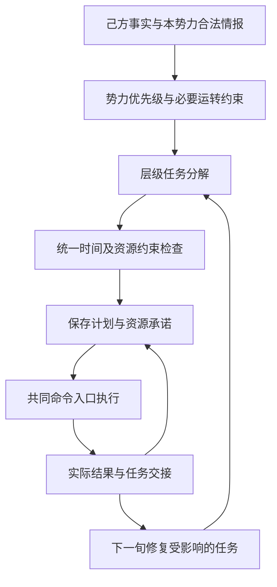

# 势力 AI 统一规划与执行架构调研

调研日期：2026-11-05。以下保留当时的架构推荐与实施规格；随后已接入受限内核、部分任务交接和授权，最新范围及未完成项见[实施报告](势力AI统一规划与执行架构实现-20261105.md)。未取得本项目全局策略收益或SOTA性能验收。

## 推荐结论

采用 **基于 Chronicle 的分层时序规划**（Chronicle-based Hierarchical Temporal Planning），以任务、时间、条件和资源约束描述整项势力计划；以统一执行监督器管理任务承诺与交接。实现中加入任务级契约，说明每一步何时可以开始、执行期间必须保持什么、何种真实结果才算完成。

这是规划与调度研究中有正式表示、约束语义和实现参考的方法。具体项目方案是结合现有规则的工程选型，不是一个已发表、在本游戏上证明领先的全新算法。没有检索到能够证明某种算法在本游戏规则及计算预算下普遍最优的基准。

用户确认的规则匹配方向继续保留：以领域规则限制分解方法和候选顺序，得到首个完整满足约束的方案后停止。约束传播与有界局部回退仍可能需要计算；不承诺复杂人员分配完全不搜索，也不进行全人员、全方向假想世界交叉枚举或全局最优性证明。

## 研究依据与适用范围

仅引用研究原文与项目官方资料：

| 资料 | 已核对的内容 | 对项目的意义与限制 |
| --- | --- | --- |
| [Chronicles for Representing Hierarchical Planning Problems with Time，HPlan 2022](https://icaps22.icaps-conference.org/workshops/HPlan/papers/paper-03.pdf) | 用有时间范围的条件、效果、子任务表达层级任务，并给出约束满足问题的语义 | 作为任务表示与相容性检查依据；不是仅给阶段数组换名 |
| [FAPE，2020](https://arxiv.org/abs/2010.13121) | 结合时间线、层级方法与规划；论文还说明系统有规划与行动结合等能力 | 支持采用领域知识约束计划空间的路线；论文成绩不外推成本项目成绩 |
| [Towards Canonical and Minimal Solutions in a Constraint-Based Plan-Space Planner，ECAI 2025 论文](https://journals.sagepub.com/doi/full/10.3233/FAIA251373) | 在约束规划表示中处理对称与不必要动作，提高所测时序问题上的表现 | 支持检查无目标贡献步骤、降低重复计划；不意味着可直接判定所有往返都无意义。出版页标注2026-08-25上线，卷名为ECAI 2025 |
| [Aries 官方项目](https://github.com/plaans/aries)与[规划接口说明](https://github.com/plaans/aries/blob/master/planning/unified/plugin/README.md) | 具有层级、时序、整数与调度建模接口，区分首个解与最优解模式 | 可作为原型或对照后端。官方将旧规划组件列为弃用，新引擎尚未功能对等；不能直接承诺其浏览器、WASM或手机集成能力 |
| [Platform-Aware Mission Planning with Task-Level Contracts，IJCAI 2026](https://ijcai.org/proceedings/2026/689) | 用开始、结束时的假设与保证检查任务组合及其实际执行平台 | 借鉴契约边界与分层验证。论文的关键限制包括平台原子任务顺序激活、不重叠；本游戏有并行任务，不能照搬其证明或宣称获得同样保证 |
| [HIMA，2025](https://arxiv.org/html/2508.06042v1) | 专门策略模块提出动作序列，由中央战略控制器整合；研究对象为TextSCII-All环境 | 支持分离提案与统一决策的结构。其学习、语言模型和实验环境不直接满足本项目的离线、确定性及共同规则要求 |

没有采用“论文中出现SOTA，因此照搬后本游戏也达到SOTA”的推断。推荐依据是问题结构匹配：跨城行动有持续时间；人员、钱粮和运力共享；存在前置依赖、部分可观察局势及已经执行的承诺。

## 当前系统需要替换的协调职责

当前已有目标评分、固定任务模板、准备预测和多类承诺，不能把它描述为完全没有规划。但这些承诺分布在进攻、集结、内政调任、支援、外交与排队军令中。只替换 `selector` 或提高前线分数，不能统一这些模块对同一人员和库存的支配权。

新的职责边界：各业务模块提出需求与合法实施方法；统一规划器分配资源并发布一份相容计划；业务执行器只执行已获授权的步骤。新计划与旧控制器不能同时拥有发令权。

旬内结果可以更新任务事实、履行预先保存的接续命令或触发共同失效处理；新的战略选择仍等待下一旬。该架构不引入旬内政策重评。

## 1. 以需求和约束建立势力优先级

先依据共同规则确认不可违反的必要条件：真实人员资格、经济必要人手、实际守备、已经支付和不可中断的工作、现役及在途状态、外交义务与钱粮承诺。

在满足这些条件的可调整资源中，按明确的优先级层次处理实际危局、有效主攻及其补给链、其他前线缺口和额外发展。同层需求再按领域规则排序；已有目标的继续价值及变更所需的未来额外成本进入判断。不能只靠一组跨模块权重相加，让可选建设因为分值较大而挤掉主攻必要人员。

后方人手由实际需求导出：

- 生产能维持必要钱粮和已经登记的后勤义务时，额外农业、商业、军务或其他发展岗位可以不满编。
- 在办建设与研究保留实际负责人；已付项目按共同规则完成。前线调任可预先排在当前事务结束之后，旧岗位不能在交接前再开新事务。
- 新研究需要的真实技术班底、太守兼任资格与其他岗位兼容关系，继续读取现行共同规则。
- 前线新增缺口与成熟后方的可调余员共同匹配。成熟度及基本人数不预设固定日期、领城身份或所有城市统一人数。

“前线优先”作为可调整资源的分配政策，不提供夺走城市必要经济人员、凭空增加研究人员或取消真实守备的许可。

## 2. 任务描述必须包含时间、条件与实际效果

例如“增强前线基地以准备某方向行动”可以分解为：

1. 确认来源城市的必要留守与正在执行的承诺。
2. 等指定人员完成已保存事务。
3. 沿实际安全道路调任。
4. 实际抵达后交接给前线岗位或作战准备。
5. 保存的准备条件满足后，按共同入口执行已批准步骤。

每个任务至少表达：所属势力与目标、上级任务、参数、前置条件、持续期间条件、资源需求、完成的真实效果、失败与中止方式、后继步骤及授权版本。

**调任完成的效果是“这个人实际在目的城”，不是“这个人重新变成全局无主资源”。** 上级前线任务继续保留其用途，执行器在相容计划中完成下一步交接。

方法分解本身不能产生世界效果。准备、预计抵达或规划中的研究人数不算真实兵力、到城人员、入库粮食或已完成设施。

## 3. 统一资源承诺

| 资源 | 约束表达 |
| --- | --- |
| 武将与真实部队 | 不相容任务的占用期间不能重叠；兼任按共同规则；军团与所属部队不能重复计入 |
| 金、粮、预备兵 | 按实际来源库、既有承诺和阶段需求分配，实际执行才扣付；预测收入不视为当前可花库存 |
| 道路与粮源吞吐 | 多项任务合计使用同一时段的实际承载，继续复用现有供给与道路查询 |
| 建设、研究、人员岗位 | 真实工位与人员同时满足；进阶研究班底不能被拆开重复承诺 |
| 日期与接续 | 完工先于离城、抵达先于到岗、实际集结先于出发；旬内只执行已保存接续 |

计划只能有一个资源承诺事实来源。现有 `plannedOfficer`、`plannedGrain` 等查询逐步成为统一承诺的查询接口，不能长期保留多套互不一致的占用表作为各自权威。

未来时间段以范围和守卫条件表达，不把预测日期当成无条件执行许可。真实情况超过范围时共同处理失效或等待，下一旬再修复计划。

## 4. 明确承诺、交接和抢占

建议采用“提出→预留→已授权→执行中→待交接→完成／失败／取消”的生命周期；这是项目实现建议，尚未修改存档结构。

预留和授权版本随存档保存。旧步骤的完成消息只能结算自己的占用，不能释放已经移交给新步骤的人员。交接应原子更新计划记录及相关排队命令，避免人员短暂回到公共人选池。

原子更新只作用于本次计划安装或交接。已经付费、移动、受伤、失守等世界事实不能通过计划回滚撤销。

抢占必须有明确理由：共同规则失效、任务目标已消失、实际生存危局，或按统一优先级批准的重新分配。不能允许每个模块只因自己发现空岗就改派已承诺人员。发生抢占时保存旧任务、新任务、实际原因及后继处理。

承诺也不能无限占住没有工作的人：有效承诺须关联实际前线岗位、可实施的准备步骤或已保存命令；如果目标不可行且没有合法补齐步骤，在旬初结束相关承诺并重新分配。

## 5. 保留计划，局部修复

每旬以当前合法事实重新核对已安装计划；已发生的结果固定为事实，有效承诺继续。条件改变时，仅重建依赖该条件的未执行任务及其资源分配。实际威胁仍可使更大范围的旧计划失效，不能因承诺而强行坚持失败进攻。

检查的是因果支持：某次调动是否支持接下来需要的驻地、岗位、补给或作战步骤。相同人员往返但没有建立任何新的必要条件，应作为计划层问题解释，而非只增加折返冷却。

还要检查任务之间的等待环。若运粮等人员、人员等岗位、岗位又等运粮，规划器必须拒绝这一组循环承诺或在下一旬重排可中止任务。统一占用表本身不会自动消除死锁。

## 6. 算法与运行成本

先由领域方法限定近期需考虑的任务及候选顺序，再处理共享约束。稀缺资格与硬性必需岗位先分配，避免先到的普通任务耗尽唯一可用人员。对冲突做约束传播及有界局部回退，得到首个完整可行方案即停止。

远期保留高层目标，近期展开可执行步骤。规划范围和候选生成不能再次变成未评估资格前永久截掉后续目标的规则；当前批失败时应有明确的后续检查或下一旬接续机制。

工作预算使用确定性的检查次数、节点数或传播次数，耗时作为监控值，避免机器快慢影响军令选择。预算不足时继续可用旧计划或保留已经验证完整的安全计划片段，不能提交只有一半人员、漏算道路或超用库存的结果。

此方案不预测未来随机结果，也不调用战斗 AI 试打。真实道路继续寻路；只读查询可共享本次不变事实，实际下令后仍须重新读取。

## 7. 方法、求解器和部署分别决定

推荐方法不等于立即把完整研究求解器装进游戏主循环。Aries 是值得做隔离原型的参考后端，尤其可检查任务表示、资源冲突和首个可行解行为。当前资料明确提示组件迁移及功能差异，尚未验证Windows发行、浏览器或Android的适配，也未测定本项目输入上的耗时。

建议先用真实保存输入构建原型，比较成熟求解器与有限领域方法驱动的实现。使用简化实现时，应报告保留了哪些形式约束与删去了哪些搜索能力，不能沿用研究求解器的SOTA性能称号。

本项目的性能与可解释性要求支持先使用规则化方法顺序和首个可行解。需要优化质量时另行提出、登记预算和评价目标，不能默认开启无限制最优求解。

## 8. 迁移与验证

1. 建立任务模型、资源类型、执行守卫和契约验证器，以保存的真实输入和单元案例验证表示；先做只读影子规划，旧控制器仍为唯一发令方。
2. 将人员任职、跨城调任、集结和运输作为一整条链切换到新协调层，检查同一人员在每次交接中的归属及必要生产。旧模块在该范围只能提出需求和方法，不能同时下新令。
3. 将守备、正式进攻、侦察、外交及其他存在共享人员和预算的战略动作纳入同一授权规则。在覆盖完成前，明确报告已统一的范围，不能宣称全部战略 AI 已重写。
4. 保留共同命令处理器、逐日模拟、战斗 AI、兵种、技能、羁绊及资源规则。新的任务模型和承诺随存档保存，并采用当前原型的旧档拒绝策略。
5. 现行战略验证协议的可编辑范围不覆盖全部协调和共同接口文件。实施前应明确新架构边界、更新协议并重新冻结；候选期间保持裁判、样本、门槛及公共规则不变。

需要独立检验的性质：

- 无不相容的人员重复授权，无库存、工位或同路吞吐重复承诺。
- 成熟后方只保留实际必要人手；额外人员在真实完工后向存在缺口的前线转移。
- 调任、到齐、等待出征之间无人员归属空档；普通任职和运输不能擅自调用。
- 真实缺粮、来袭与任务失效能够合法打断或取消，不因旧承诺阻止救急。
- 不读取隐藏实时信息；旬内无新战略决策；相同存档确定性续行。
- 同目标反复搬人的数量、对实际需求的兑现、持续作战、现役保有和成本分别留证。不能仅以任务数下降或减少战争证明改进。

先封存行为案例、相关回归和独立自然保护窗口，再扩大到原停滞阶段。任务模型测试通过只证明形式和接口部分；全局战略收益、完整可玩性、自然统一及设备性能仍分别验证。

## 调研后的决策

建议以“统一的、受资源约束的分层时序计划＋明确的执行与交接契约”作为重构主线。首个交付物应是能解释和约束当前往返、抢人和重复预算的计划模型及隔离原型，然后替换调配决策权。当前仍为研究推荐，未安装求解器、未改变战略行为，也未宣称达到SOTA或通过后期验收。
