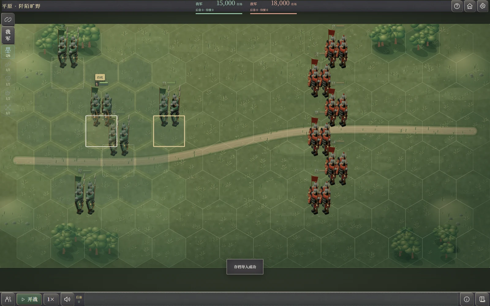

# 玩家行动交互流程

更新日期：2026-11-01。适用于当前普通模式与独立战役，供玩法查阅、界面设计和交互验收使用。下文按实际入口说明玩家做什么、何时生效、如何返回，以及结果在哪里查看；费用、人数、资格和结算由对应规则处理。

带逐项截图的版本见 [玩家行动交互图册](玩家行动交互图册.html)：按分类或行动名称检索，切换关键步骤截图，点击图片放大。图片来自当前程序的隔离演示存档；控制伤亡、充能、资源或最终归属的样本在图片下方注明，不作为自然 AI、平衡或统一证据。

普通模式多数军政命令在筹划阶段安排，点击“进行”后按真实日期执行。战前、援军抵达、待审批及战后补任有各自的暂停与确认边界。浏览、设置和开局编辑另列，不算作势力 AI 的游戏决策。

## 查阅入口

| 要做的事 | 流程 |
| --- | --- |
| 找城市、人员、军团或查看情报 | [地图与查询](#地图与查询) |
| 委任内政、安排太守、批准事务、设置预算 | [内政与城市人事](#内政与城市人事) |
| 派斥候、停止侦察 | [侦察](#侦察) |
| 编制、出征、讨伐、增援、改道或返城 | [城市部队与出征](#城市部队与出征)、[军团行军与整军](#军团行军与整军) |
| 调任、运送钱粮兵源、接力或分批运输 | [调任与运输](#调任与运输) |
| 处理工作冲突、等待和取消军令 | [执行时机与等待命令](#执行时机与等待命令) |
| 外交、俘虏、宝物 | [外交与俘虏](#外交与俘虏)、[宝物](#宝物) |
| 守城、布阵、援军军议、军略和撤退 | [战前准备与布阵](#战前准备与布阵)、[战斗与战后](#战斗与战后) |
| 开局、历史战役、自定义战役、地图编辑 | [开始游戏与编辑](#开始游戏与编辑) |
| 继续时间、看奏报、保存读取 | [时间与结果查阅](#时间与结果查阅)、[存档与设置](#存档与设置) |

## 共用交互约定

### 选择与信息展示

需要目标的行动遵循“来源 → 执行人或部队 → 合法目标 → 预览与调整 → 确认”。从城市、军团或人物入口进入时沿用明确上下文，不重复选择固定来源。没有空间目标的委任、预算、全军效果按各自流程处理。

主页面只保留名称、人数、资源、状态、费用、时间、风险和必要按钮。外交与宝物授予不重复复述已选对象；编组、整军、战报与回放不常驻流程或规则段落。援军保留后备状态，战报保留实际参战与未抵达名单；替换宝物、交接事务和失城等操作后果仍须显示。能力完整效果、路线明细、条约履行和人物生平按需查看；不把本文流程段落常驻到游戏界面。短按钮使用“确认、取消、返回、下令”等名称。目标地点优先在真实地图选择，搜索只定位。

候选按本方合法情报与真实资格生成。禁用时给出具体原因，例如没有可用人员、尚未任命、资源不足、超过队数或道路不可达；隐藏区域不显示实时敌军、库存或后续命令。数字输入中的钱、粮和人数使用整数。

### 返回与提交

| 操作 | 应理解为 |
| --- | --- |
| 查看详情、折叠内容、筛选、排序、地图缩放与定位 | 浏览，不提交行动；返回原操作保留草稿与列表位置 |
| 上一步、从详情返回 | 继续修改当前草稿，不撤销已独立确认的其他行动 |
| 同值重选 | 不改变依赖项；重复选同一终点不抹掉手调路线 |
| 更换来源或人员 | 清理已经不适用的下游选择；具体依赖见各节 |
| 取消当前选点或拖动 | 返回本次操作前的草稿；路线拖动时 Esc 只取消这一拖动 |
| 取消整个未提交命令 | 不扣费、不建立部队或军团；本次命令结束。重新进入不保证恢复临时草稿 |
| 最终确认或下令 | 重新校验实际人员、资源、道路和目标；通过后生效或进入已保存的等待命令 |
| 关闭待审批、待指挥或待补任页面 | 不等于批准或完成，不绕过必须处理的事项 |

不能把所有页面都理解为“关闭即撤销”。内政优先顺序、部分军议设置和宝物装备是即时操作；城市预算在点击“保存预算”后生效。它们的生效点在下表单独标出。临时命令草稿也不同于已保存的等待命令，刷新或读档不会自动提交草稿。

复杂行动的确认页保留所选对象、实际费用、终点与必要后果；简单委任选完直接确认，不增加重复核阅页。多步页面以当前动作作标题，不显示数字步骤条。放弃守城、释放及赎回俘虏先确认对象和后果，取消返回来源页面。

## 地图与查询

| 行动 | 入口与操作顺序 | 结果与返回 |
| --- | --- | --- |
| 打开城市命令 | 左键点己方城市 → 信息卡片 → 委任／军事／人事／详情；军事展开编制、出征，人事展开武将、调任、太守 | 城市、府和军团共用点选卡片，悬停不弹信息卡；换选对象替换卡片，点空白或 Esc 收起。缩放与查找继续定位地点，管理和完整详情须主动进入 |
| 查找空闲人员 | 自辖城市 → 可筛“有空闲”或按地名、姓名查询 → 点城市定位 → 安排事务 | 列表保留，可连续切城；灰色表示无空闲人员，仍可选择 |
| 查找军团或战线 | 地图点军团或本势力军团列表 → 信息卡片与当前粮道 → 驻守、变更目的地、详情或管理；战线列表 → 选择战场 | 卡片列出现役兵、伤兵、部队数、士气、每日耗粮和携粮／容量；己方军团高亮当前接通的粮道并注明供粮城市，换选切换，断开不画旧路线。点选只查看；完整详情和业务操作须明确进入，返回保留来源列表 |
| 查阅人物与部队 | 人才 → 人才名册 → 任职／能力／兵种适性／特性／羁绊／战法／军略；点击姓名进入对应资料页。头像或部队图形仍进入对象详情 | 枪、戟、骑、弓四系适性可分别排序，顺序为 C／B／A／S；特性和羁绊、战法和军略各自独立。部队列表及战场详情显示当前兵种适性，所属武将可查四系适性；个人详情显示当前忠诚。返回保留分栏、查询、排序和滚动位置，查看不改变游戏状态 |
| 查询敌情 | 情报入口 → 类别 → 本势力／天下 → 查找或排序 → 对象与情报日期 | 各类别和范围分别保留查询、排序及列表位置；当前视野内可实时查看城内武将详情和忠诚，我方实际关押或押送的俘虏也可查看；所有视野覆盖消失后隐藏敌方人物详情，不加入人物侦察报告。据点兵粮与设施仍可查看带日期的旧情报 |
| 查看城内与建筑 | 继续放大或双击城市，或府、港口、关卡 → 查看建筑 → 实际建筑、施工或人员头像 → 状态与负责人 | 只读设施等级、地点、进度和效果；无逐项手动建设按钮 |
| 地图选点 | 行动页进入地图 → 点合法目标 → 预览选中对象 → 确认返回 | 取消保留来源草稿；地图拖动、缩放和名称查找不代替选取或下令 |

来源：[城市菜单](../map-object-menu.mjs)、[全势力名册](../faction-directory.mjs)、[详情面板](../detail-panels.mjs)。

## 内政与城市人事

城市“委任”列六个方向、岗位人数和负责人、太守审批委托和未委托人员事务，城市名置于窗口副标题；进入方向后查看岗位并委任、解除或调整人选。资源冲突裁决、太守审批、人员事务、方向优先级、统一委任和内政纪事统一从主界面“内政”办理；外交与侦察也从主界面按势力统一安排，城市菜单不再提供侦察入口。方向标题只用“人才”“农业”等名称，不拼接能力标签；所需能力及数值在选人表中比较。资源与预算从据点详情查看，岗位扩容规则在主动打开的内政说明中查看。主界面内政无资源冲突时仍保留城市审批和未委托城市的人员事务表，列出姓名、事务、费用和耗时。详情中的部队按姓名、兵种、兵力分列。军团详情按天显示交战时间，路线预览显示预计抵达天数。各表使用姓名、所在、兵力、耐久等简短列名；预算表按现存、收入、支出、预留、结余分列，表题标明未来一旬。

| 行动 | 入口与操作顺序 | 生效与失败处理 |
| --- | --- | --- |
| 委任内政负责人 | 己方城市 → 委任 → 方向 → 空岗位 → 选择本城人员 → 确认 | 无冲突直接任命；有当前事务进入执行时机选择。选人页直接确认，无额外核阅页 |
| 改任内政方向 | 目标方向 → 选符合资格的现任人员 → 确认 → 必要时选立即执行／办完执行 | 待任也占目标岗位；满员或人选失效不能提交 |
| 解除内政 | 方向内现任负责人 → 解除 → 若有事务，选择执行时机 | 解除任职不解散城内部队；取消时机选择不解除 |
| 任命或更换太守 | 筹划阶段 → 点击己方城市 → 人事 → 太守 → 比较政治、任职特性及事务 → 选择本城合法武将 → 确认 | 任命不自动开启审批委托；选人页可点指引或按 F1。更换人选收回原审批委托 |
| 解除太守 | 点击己方城市 → 详情 → 管理 → 展开太守 → 解除 | 解除任命及该城审批委托，不解除其他内政职务 |
| 调整全势力内政优先级 | 内政 → 委任优先级 → 方向右侧上移或下移 | 每次调整即保存本势力顺序；关闭不回滚；首位不能上移，末位不能下移 |
| 补齐全势力委任 | 内政 → 查看委任优先级 → 表头统一委任 | 按当前优先级使用真实合法人选，反馈实际补齐数量；不虚构人员 |
| 同意一项内政提案 | 旬初筹划 → 点击进行 → 统一提出提案 → 主界面内政 → 提案 → 查看人员、地点、费用、耗时和资源缺口 → 调整本城预算或安排 → 同意 | 按原案复核后扣费开办；失效时保留失败原因，不自动换事或换址 |
| 暂缓提案 | 旬初提案 → 可按提案类型筛选 → 逐项暂缓，或核阅后暂缓本页 | 不支用资源，保留方向任职，本旬不反复提交同一提案；批量仅处理当前筛选显示的提案 |
| 同意本页提案 | 旬初提案 → 可按提案类型筛选 → 核阅当前显示的事项与费用合计 → 同意本页 | 逐案校验，反馈成功数量及失败原因；可能只成功一部分，不承诺整页原子提交 |
| 委托太守审批 | 先从城市人事任命太守 → 主界面内政 → 城市审批 → 找到本城 → 开启太守审批 | 任命与委托分开；关闭可收回。太守按真实预算代批或缓办，汇报收支与异常；更换、解除、离城或易主后须重新委托 |
| 修改城市保留预算 | 城市详情 → 收支预算 → 修改保留金／粮 → 保存预算 | 编辑时显示“未保存”；两项都通过整数与范围校验才一起生效。重置恢复已保存值；关闭不提交，本次界面会话可保留草稿，读档清空 |
| 安排人才工作 | 从忠诚偏低提醒点击“人才事务”（也可从城市“委任”进入“人才”） → 选择负责人并确认 → 主界面内政查看办理情况、必要时处理资源冲突 → 人才名册“能力”页查看忠诚 | 人才方向使用魅力；可离间当前可见邻城的高忠诚非君主武将，初值240金、当地办理10天、普通成果降低12点，实际付费赴访且本城同类事务结算后冷却30天。低忠诚后仍须另行劝说、签约。安抚优先选择本城忠诚最低的合法目标，基础120金、10天、恢复15点忠诚，实际效果受成败及特性影响。委任或同意不会立即增加忠诚；实际脱离低忠诚状态后清除提醒。辞官与改仕没有倒计时或预告日期，发生后才通知；任职满30天不会直接消除低忠诚。人才事务及赴任仍由后台办理 |

选人表只展示该方向相关能力、适用特性、所在、任职和当前事务。顶部显示已任、待任与本次选择的总占用人数／上限；满员后其他候选禁用，已选仍能取消。城市已编部队的武将不因“已编制”直接失去内政资格。

选人信息按任务区分：

| 任务 | 用于比较的信息 |
| --- | --- |
| 商业、农业 | 政治、相关特性、所在、任职、事务 |
| 军务／武备／技术／人才 | 分别为统率／武力／智力／魅力，其余同内政选人 |
| 太守 | 政治、任职特性、所在、任职、事务 |
| 调任与运输 | 五项能力、运输特性、所在、任职、事务；物资与路线确定后再核对到达时间 |
| 新编部队主将 | 统率、武力、智力、四系兵种适性、带兵上限、相关特性；普通模式补任职与事务，独立战役不虚构内政占用 |
| 出征部队 | 兵种与适性、兵力、统武智、任职、事务、战法、羁绊、友好度；连携矩阵按需展开 |
| 军团长、军师 | 统率与智力、任职特性、任职军略；分别将统率、智力排在前面 |
| 侦察 | 仅列可用人员，比较智力与对应视野时长 |
| 外交 | 交好看魅力、通商看政治、交涉看智力，并显示适用特性、任职与在办事务剩余时间 |
| 拆分军团 | 兵种适性、现役、伤兵、统武智、羁绊，不混入补兵指标 |
| 征募整补 | 兵种、现役、伤兵、带兵上限、可补兵员 |

事务统一显示剩余时间、暂停标识及待执行命令；选人、排序与查看不改变办理进度。新编部队尚未分配兵数，不将现有兵力作为主将比较列。

商业、农业对应政治，军务对应统率，武备对应武力，技术对应智力，人才对应魅力。建设、修缮、研发、运营和招揽的具体事务由负责人拟定；没有额外的逐设施建设、指定研究方式或手动战法学习流程。

来源：[战略命令](../strategic-command.mjs)、[方向岗位](../domestic-direction-view.mjs)、[提案视图](../domestic-proposal-view.mjs)、[内政规则](内政系统最终设计.md)、[人才视图](../talent-view.mjs)。

## 侦察

| 行动 | 入口与操作顺序 | 生效与返回 |
| --- | --- | --- |
| 派遣侦察 | 主界面侦察 → 城市表 → 本城武将表 → 周边终点表或地图选点 → 预览并拖动路线 → 派遣 | 主界面入口先选派出城市，不自动选人；通过校验才建立待出发任务，实际执行前不扫描或发现贼寨；地图确认同一终点保留中转点，取消保留草稿。沿途留下固定地点、有期限的视野，类似侦察守卫；斥候离开或停止后，覆盖区域到期前仍实时可见，浏览与读档不移动或延长期限 |
| 调整侦察路线 | 已选终点 → 拖动路线中转点至合法节点 → 核对终点和预计抵达 | 拖动只改草稿；同一终点重选保留路线；“重置路线”主动清除中转点 |
| 查看报告 | 侦察任务 → 情报 → 查看对象与日期 → 返回 | 保留任务，不刷新情报日期或视野期限 |
| 停止侦察 | 侦察中任务 → 停止 | 立即释放在城负责人；已经点亮区域按原期限保留，不立即抹掉 |

更换派出城市清空执行人、终点与路线；更换执行人清空终点与路线。执行人留在原城，移动的是独立斥候。终点只含合法周边道路节点和相邻城市，手动改线也不能穿城或绕入更远城市范围。

大地图上的骑马斥候按实际道路移动，标签显示所属军队与任务状态；点击或用键盘打开模型可进入侦察任务。待出发或暂停时不播放赶路动画，抵达后立即移除模型与任务并释放负责人。

预览显示预计用时、费用和本城金，预计天数按实际选定路线计算，费用初值为每天10金，改线同步更新。底部摘要常驻显示天数和费用，手机也可直接核对。确认派遣才从派出城一次付清；余额不足不扣款、不解除旧工作。派遣前取消免费，派出后停止不退已付费用。斥候经过即获得所遇情报，抵达后完成最后观察并立即移除、释放负责人；已有固定视野与据点报告保留，不自动续期。视野期限仍同时标注回合、天数。

来源：[侦察界面](../scouting-view.mjs)、[路线编辑](../map-route-editor.mjs)、[战争迷雾与武将侦察](战争迷雾与武将侦察.md)。

## 城市部队与出征

| 行动 | 入口与操作顺序 | 生效与返回 |
| --- | --- | --- |
| 新增城内部队 | 城市 → 军事 → 编制 → 新增部队 → 在表单选择主将 → 兵种、兵力和装备 → 确认该队 → 返回列表 → 核阅下令 | 单队表单只改草稿；最后下令才更新真实编制和费用 |
| 调整城内部队 | 编制列表 → 选已有队／直接修改名单字段 → 核对适性、兵力、装备与费用 → 最终下令 | 详细属性按需查看；返回和取消不部分扣费 |
| 解散城内部队 | 编制列表 → 解散目标队 → 查看待解散及兵员返还 → 最终下令 | 实际现役与伤兵返还本城预备兵，编制费用不退；武将及内政任职保留。等待出征者须先取消命令 |
| 从现有部队出征 | 城市 → 军事 → 出征 → 选择已编部队 → 军团长、军师 → 地图终点及路线 → 核阅 → 下令 | 已有可用部队时直接进入选队；最终军令生效才创建在外军团 |
| 出征前临时编制 | 出征选队页 → 编制 → 新增／调整部队 → 返回选队 → 继续任命与选路 | 无现成部队时先进入部队管理；编制与选队往返保留草稿，不要求退出重新进入 |
| 移除已选部队 | 出征已选条 → 目标部队“×”，或取消对应勾选 | 只从本次出征选择中移除，不解散部队；焦点接到相邻已选项，空时回候选列表 |
| 讨伐贼寨 | 已发现贼寨 → 查看带日期的情报 → 从可达来源城入口出征 → 选队、任命、预览路线 → 下令 | 贼寨地点带入目标，共用真实出征与战场；缴获随幸存部队返城，不靠关闭战报领取 |
| 增援与护路 | 先确定来源城或己方军团 → 使用出征／调动 → 选实际战场或需要驻守的道路节点 → 预览 → 下令 | 以实际抵达进入援军或驻守处理；没有点击目标即获得增援的捷径 |

选队页同时比较能力、兵力、固定战法、羁绊及与已选成员的关系，完整关系矩阵按需展开。每军团最多十队；选择部队阶段不安排战场站位。军团只任命军团长、军师，首发和出阵顺序留到战前军议。

兵数可输入整数、拖滑条或使用最小／最大按钮。无效输入保留并提示，阻止继续，不静默截断。上限按真实带兵容量、伤兵、本城预备兵、其他草稿占用及费用核对。

修改出征队伍或影响行程的编制会清理依赖的目标与路线；仍合法的指挥人选保留，离开已选名单的人选清空。同值字段修改、同一任命或终点重选不清路线。

来源：[编制与出征](../strategic-command.mjs)、[部队比较](../combat-comparison.mjs)、[贼寨入口](../bandit-view.mjs)、[共用交互](战役与普通模式共用交互.md)。

## 军团行军与整军

| 行动 | 入口与操作顺序 | 生效与返回 |
| --- | --- | --- |
| 下达调动或改令 | 旬初筹划时点己方未交战军团 → 变更目的地 → 途中军团选择继续前行或原路折返 → 地图终点 → 拖动中转点 → 确认终点 → 核阅 → 下令 | 沿用该军团，不重复选将；默认走完当前路段，也可从实际位置沿原路折返，再从返回节点衔接后续路线。切换方向清空原终点及路线，需重新选择；可直接选择该方向路段终点停驻。两页注明行进方向、预计天数及沿途接敌风险；取消保留原军令。执行中或交战中不能改令 |
| 就地驻守 | 旬初筹划时点己方未交战军团 → 驻守 → 核对后确认 | 取消原行军及待执行安排，保留当前地点或道路途中位置；继续耗粮、补给和接敌，不瞬移至节点。水上驻守仍留在原水路，之后只能经原路两端港口改道；取消不改变原军令 |
| 返城或驻守节点 | 军团调动 → 选择己方城市或合法节点 → 路线与补给预览 → 下令 | 抵达城市才按实际条件交接；驻守府、港口、关卡仍是军团，不产生节点独立内政 |
| 重置行军路线 | 当前选路页 → 重置路线 → 核对默认道路 | 保留目标，清除手动中转点；最终下令前不改变真实军令 |
| 切换行军方式 | 军团 → 行军方式 → 选择可用方式 → 核对速度、携粮、士气与休整 → 确认 | 共同处理器复核资格与交接地点；失败保留原方式，取消不切换 |
| 调整军团编制 | 军团管理 → 整军 → 调整编制 → 修改合法兵种／装备 → 任命 → 比较前后与费用 → 确认 | 详细属性在配置或核阅页展开，没有独立重复属性核阅步骤 |
| 拆分军团 | 整军 → 拆分 → 选择另立军团的队伍 → 配置 → 新军任命 → 核阅新旧两军 → 确认 | 两军均须保留真实有兵部队；失败不拆一半、不部分扣费 |
| 合并军团 | 整军 → 合并 → 选择同地合法军团 → 核阅合并结果与费用 → 确认 | 合并后最多十队；候选不存在、在途或任务限制时不能提交 |
| 征募整补 | 整军 → 征募整补 → 选择需补的队伍 → 核阅补后兵力与消耗 → 确认 | 只补所选队，使用实际驻城预算和兵源；道路节点不提供征募 |

选路预览保留终点、预计抵达、耗粮及危险信息，详细道路按需展开。水路、港口上下船、山道禁连与部队速度使用真实规则；选择船只不会允许穿山或从河中任意上岸。拖路线中按 Esc 取消当前拖动，页面与上一条合法草稿保持。

选路时地图上的军团、斥候、运输队与战场标记只提供位置参考，包含士兵图形在内均不得遮挡下方终点。手动核对：让军团图形与城市重叠，进入调动，点击该城市应选中终点而不是打开军团；退出选路后军团卡片仍能正常打开。

来源：[整军流程](../military-flow.mjs)、[共同整军处理器](../army-management.mjs)、[逐点选路](大地图逐点选路-规则63.md)。

## 调任与运输

| 行动 | 入口与操作顺序 | 生效与返回 |
| --- | --- | --- |
| 纯人员调任 | 来源城市 → 人事 → 调任 → 本城人员 → 地图选择其他友城 → 物资保持零 → 核阅 → 下令 | 仅未携带现役、伤兵和物资时为轻装调任；已编制部队会随主将形成运输队。途中不能在目的地任职，到达后才交接 |
| 携兵或携物资运输 | 来源城 → 人事、调任 → 选人并核对随行部队 → 地图选友城 → 填金粮与预备兵 → 核对抵达天数 → 下令 → 地图点运输队查看进度 | 运兵、运物资和混载统一形成可见运输队，按常行步兵军团基准的1.5倍速度逐段移动，每天至多完成一段；途中遇敌损失，到达后才交接 |
| 接力运输 | 单名具备接力资格的人员 → 目标与物资 → 展开运输选项 → 地图选择接力城 → 核阅下令 | 仅合法特性显示此选项；“直达”清除接力城，取消地图选点保留原选择 |
| 分批运粮 | 单名具备往返运粮资格的人员 → 目标与物资 → 运输选项中选择批次 → 核阅下令 | 显示首批预计抵达，后续批次按真实往返、装卸与库存执行，不把未来粮算作已入库 |

调任／运输共用同一入口。当前目标在地图选择，页面不提供独立的逐点手绘人员路线流程；接力是有资格时的运输选项。运输行程按当前水陆路段与接力停驻估计；物资种类及运粮特性不再提供额外速度加成，空车返程同样按运输速度。

更换执行人员清空目标、路线、接力、物资与批次，避免把上个人的运输安排带给新人。同一批人员重选不清空。数量输入时即时校验整数、非负值与可用库存，只更新摘要和资格；不重建输入框或按钮，输入后一次点击即可继续。返回核阅前页面保留输入和栏内滚动位置。

来源：[战略命令](../strategic-command.mjs)、[真实人员移动](../personnel-movement.mjs)、[人员移动与战后去向](人员移动与战后去向.md)。

## 执行时机与等待命令

| 选择 | 玩家流程 | 执行结果 |
| --- | --- | --- |
| 立即执行 | 完整提交新命令 → 冲突页核对人员、在办事务与投入 → 立即执行 | 中止原事务，已付费用按原规则处理；外出人员仍须真实返程或衔接，不能传送 |
| 完成后执行 | 改任、解除或调任 → 冲突页 → 办完执行 | 保存等待命令，原事务继续，相关人员不再开启下一项事务 |
| 返回修改 | 冲突页 → 返回 → 修改原命令草稿 | 不选择任一执行时机，不中断原事务 |
| 取消等待命令 | 人员／事务中的待执行命令 → 取消 | 只撤销后续命令，不中止仍在办的原事务，也不召回已经出发的队伍 |

批量改任可按各人完成情况分别生效。玩家指定出征、侦察时，冲突页列出可解除任职和当前事务，确认后立即中止并执行；取消或新令失败保留原工作。外出人员仍须真实返城。AI保存的等待出征安排保留准确人员、配置与道路，不提前创建军团。实际执行时再次核对人员、目标和道路；失效记录原因，不能仅凭曾确认就强制执行。

已开始工程延期仍是同一项事务，不把延期当作完成。等待安排随当前存档保存，读档不重开原事务、不重复付费。详情浏览与临时草稿取消不等于取消已经提交的等待令。

来源：[共同军令](../strategic-orders.mjs)、[执行时机视图](../strategic-order-view.mjs)、[内政中断与后续命令](内政中断与后续命令.md)。

## 外交与俘虏

| 行动 | 入口与操作顺序 | 生效与返回 |
| --- | --- | --- |
| 设置外交目标 | 主界面 → 外交 → 选择目标 → 地图选择重点势力或自主选择 → 确认 | 只保存方针，不批准任何具体交易 |
| 设置外交底线 | 外交 → 经费与留存 → 行资、保留金粮和预备兵 → 保存 | 保存预算限制；实际交易仍须批准并复核库存 |
| 委任使臣 | 外交 → 负责人 → 对应方向 → 城市表 → 本城武将表 → 委任 | 有内政冲突时选择立即执行／完成后执行；实际接洽、出使、谈判由后台办理 |
| 解除使臣或取消待任 | 外交 → 展开负责人并召回使臣，或在返城后安排中取消安排 | 按实际在城、在途和外交状态处理；不会通过关闭页面解除，也不瞬移返城 |
| 批准外交方案 | 待处理方案 → 核对购入／出售方向或对方提议 → 看我方给予、对方给予、期限 → 按需展开条款与进度 → 批准 | 批准当前完整版本，随后复核并签署、履约；批准本身不直接结清货物和出兵 |
| 交涉或否决方案 | 待处理方案 → 交涉／否决 | 交由使臣处理；新版本需要新的批准，不能沿用旧批准覆盖实质变化 |
| 查看履约 | 外交 → 接洽中或展开条约与履约 → 展开对应方案的条款与进度 → 查看实际交付、截止日期及失败原因 | 只读；未读、关闭或超期都不等于批准 |
| 释放本方所俘人员 | 情报 → 天下 → 武将 → 被俘人物 → 释放 → 核对姓名和返城后果 → 确认 | 确认时复核资格，成功后释放并返回更新后的名册；取消返回人物详情，不释放 |
| 赎回己方被俘人员 | 被俘人物详情 → 赎回 → 核对真实赎金与返城后果 → 确认；也可通过外交形成赎回方案 | 直接赎回确认才付款，取消不扣费；外交仍按批准与履约流程。押送未到、资金不足或外交锁定时不能强行执行 |
| 通过外交交换俘虏 | 外交负责人形成含俘虏条款的方案 → 核阅双方对象 → 批准 → 实际签署交接 | 沿用外交条款，不另造免费交换或强制接受流程 |

外交弹窗首先展示势力、交情、交易倍率及每列一个动作的解锁表；已解锁显示标记，未解锁灰显交情门槛。待处理方案直接展示，负责人、预算、历史与条款进度按需展开。人才接洽、资源交易、和平换城、军援、停战和路权等具体方案由后台提出；玩家不需要逐项编辑原子条款。钱粮兵源按双方约定城市真实收支，不是全势力合计库存直接通用。条款详情中的“收支地点”只说明收付款来源；只有“移交城池”条款才会改变城池归属。普通换城须选择调整边境、双方各有至少两座主城，按城池价值、地理得失与补偿议价，交情只影响报价倍率；战时也可办理且不自动停战。减少战线可提出单方割地停战，按割地代价与停战收益评估，交城方仍须至少两座主城。都城及最后原有主城不能交出，割地停战须实际交城后才开始完整保护期限。

来源：[外交界面](../diplomacy-view.mjs)、[外交系统](外交系统设计.md)、[人员命运](../officer-fates.mjs)。

## 宝物

| 行动 | 入口与操作顺序 | 生效与返回 |
| --- | --- | --- |
| 授予宝物 | 势力宝物或武将“授予与国库” → 选择类别与宝物 → 授予 → 接收武将表 → 查看同类替换提示 → 确认授予 | 双方未出征时立即移交，跨城不需要运输；取消保留原物 |
| 收回国库 | 宝物列表 → 目标原物 → 收回国库 | 当前为直接操作，校验通过即生效；武器、坐骑、其它各装备一件，同类替换后原物归还势力国库 |
| 查看三类装备 | 武将或部队详情 → 宝物 | 武器、坐骑、其它各一个栏位，图片与名称按实际装备显示；三件可同时生效 |
| 查看效果与锁定 | 宝物列表 → 筛选可分配、随军锁定、随俘封存或国库 → 点名称 | 只读效果与条件；随军、参战、撤离者全部随身宝物锁定，包括三类全部装备 |

内政、侦察负责人及非军事外出人员按现行资格可分配，不把所有“外出”一概当作出征。授予不会复制原物，也不会刷新已经发生的战场首次入场收益。

来源：[宝物界面](../treasure-view.mjs)、[共同宝物处理](../treasures.mjs)、[宝物规则](宝物系统设计稿.md)。

## 战前准备与布阵

布阵时悬停、聚焦或点击部队，可查看支援范围与优先候选。拖动或交换时按草稿更新，确认才改变站位。站位决定优先组，组内按需要选择；距离只检查射程，不按最近选择。当前有需要不代表施放条件已经全部满足。

| 行动 | 入口与操作顺序 | 生效与返回 |
| --- | --- | --- |
| 处理新战线 | 待处理战线 → 查看敌情 → 整备部队 → 亲自指挥／委托作战 → 确认 | 只确认当前战线，其他未处理战线继续阻止推进；返回地图不代替决定 |
| 临时守城编制 | 守城准备 → 守城编制 → 合法在城武将和真实兵源 → 核阅下令 → 返回战前准备 | 仅真实参战者按规则中断事务；不提前投入未到援军 |
| 自动编制守城 | 守城准备 → 核对自动方案的金与预备兵 → 自动编制守城 | 当前按钮直接应用共同守城方案，返回军议后不能靠关闭撤销已编制结果 |
| 放弃无兵守城 | 无现役守军的准备页 → 放弃守城 → 核对将交出的城市 → 确认 | 确认时共同处理器再次复核并交接城池；取消返回准备页，关闭不等于放弃 |
| 任命参战指挥 | 战前或到达军议 → 选择本军团合法军团长、军师 → 确认该军任命 | 限本军已抵达、存活、有兵且未撤离人员；改任不刷新冷却、次数、战意或旧效果 |
| 排列出阵顺序 | 底部后备席 → 拖动队列 → 松手预览并确认 | 后备席常驻，队伍较多时横向滚动；开战按钮锁定部署，关闭军议不整体回滚已改设置 |
| 调整首发站位 | 桌面或手机直接拖我军图形／头像／名牌至合法格或我军交换对象 → 松手预览 → 确认；也可从详情“调整站位”点选目标 | 确认才应用本次站位；取消、手势中断或无效落点保持原位置与存档。轻点部队只查看详情 |
| 设置后备入场位置 | 底部后备席 → 点部队查看详情 → 入场位置 → 点合法位置 → 预览确认；详情“自动入场”可清除指定位置 | 只影响共同规则下的后续入场，不直接召入或移动在场部队；待援部队抵达后才能设置 |
| 设置战斗意图 | 开战前军议 → 选择合法意图 → 核对部署 | 选择后写入战前设置，开战后锁定；不新增战中逐队追击或移动指令 |
| 设置自动撤离人数 | 军议 → 单队填写剩余现役人数，或勾多队／全选后批量应用 | 设置人数阈值，留空为不自动撤离；不是百分比档位，也不是立即离场 |
| 设置撤离目的地 | 普通模式军议 → 撤离节点 → 地图合法节点 → 确认 | 候选按本方情报和真实道路生成；独立战役没有全国返城节点选择 |
| 重置阵型 | 开战前 → 军议图标 → 重置图标 | 立即重设开战前部署，仍不开始战斗；不表示撤销其他已确认任命 |
| 开始战斗 | 完成任命、部署、顺序、意图与撤离设置 → 开战 | 复核合法部署后锁定；未确认的站位预览须先确认或取消 |

通常同时首发六队；合法奸雄军团的额外名额按实际规则处理。军团编组人数、战场在场人数、后备人数是不同概念。军议可用人员以实际抵达为准，不借用别军或未到援军。

来源：[遭遇流程](../military-flow.mjs)、[军议](../battle-council.mjs)、[战场任命](../battle-appointments.mjs)、[后备位置](../reserve-entry.mjs)、[撤离与战前设置](部队撤离与战前设置-规则65.md)。

## 战斗与战后

| 行动 | 入口与操作顺序 | 生效与返回 |
| --- | --- | --- |
| 查看战场与部队 | 战场 → 点部队、名牌或头像 → 兵力与战意简报 → 点击状态名或悬停查看效果；战法与完整属性按需查看 → 返回 | 只显示个人实际获得的战法；大小战法均可使用武技、谋略或营务威力，点招式查看当前对应威力及效果。详情期间保持暂停；状态名直接提供效果、来源、剩余回合或次数及属性影响，不设“状态详情”按钮。点击固定展开，再点或按 Esc 收起；手机轻点、键盘聚焦同样可查。收起状态说明保留部队面板，不因点击另一队触发攻击、布阵或刷新状态 |
| 查看战场指引 | 首次战斗自动显示操作入门 → 下一项按钮与图标 → 去布阵并实际开战 → 自动显示实战建议 → 下一项状态 → 完成 | 每项均暂停，可用关闭按钮、右上叉号或 Esc 跳过全部剩余指引，之后战斗不再自动弹出；右上问号仍可随时重看四主题，F1 可打开当前页面分步指引 |
| 暂停与变速 | 大地图或战斗界面点击进行／暂停，或可用时按空格；速度按钮切换播放速度 | 主动暂停及查看部队详情时，所有战场按统一世界时钟同步暂停；继续后同步推进。切换战场确认后加载完成会自动继续；不改变真实战略路程、口粮或移动规则 |
| 施放全军型军略 | 军略（暂停） → 核对真实来源、充能、冷却与次数 → 点击合法军略 → 自动继续战斗 | 无空间目标的效果直接提交；通过校验才消耗，短暂标记实际作用对象 |
| 施放范围军略 | 军略（暂停） → 选择可用项 → 地图落点 → 必要时旋转 → 核对敌我队数与目标头像、姓名 → 施放 → 自动继续战斗 | 确认才消耗和结算；取消／Esc 或失败保持暂停，保留进度 |
| 全军撤退 | 军略（暂停） → 军令栏的全军撤退 | 共同处理器下达撤退，部队真实走向出口；不是结束页面或瞬间返城 |
| 援军抵达军议 | 真实到达触发暂停 → 核对本军新到人员 → 合法任命、后备顺序、入场位置和撤离设置 → 继续 | 不移动在场部队、不改已锁意图，不重发开场收益 |
| 查看或接管其他战线 | 战斗顶部“切换视图”下拉选择其他战场或大地图，或在大地图点交战标记 → 核对目标及战斗将继续进行的提示 → 确认 → 加载完成后自动继续 | 玩家同时只指挥一场，原战场交 AI 继续作战；返回大地图也继续后台战斗。取消、关闭或 Esc 保留原场与原播放状态。加载按实际准备显示，不重置伤亡或冷却；待部署、援军军议、筹划及其他必办事项仍须确认，读档不自动开播 |
| 核阅战果 | 战斗实际结束 → 胜负、兵损、接收伤兵、人员去向、成长及任命变化 → 返回 | 结算先发生，查看不重新奖扣；普通模式继续真实撤离、返城和补兵 |
| 战后补任 | 战后仍存军团出现缺职 → 从该军合法现役人选选择 → 确认 | 补齐前暂停推进；关闭与读档不能自动确认，已解散军团不虚构任职 |

部队移动、普攻、固定战法、正常补位和按阈值撤离由引擎自动执行。没有玩家逐队手动接应、转进、拉扯、指定战斗移动路线或重新排列战法的操作。

来源：[玩家事件入口](../app.js)、[战斗引擎](../engine.mjs)、[军略范围](军略资格与施放-规则51.md)、[战后任命](../postbattle-appointments.mjs)。

## 开始游戏与编辑

首页主菜单依次为“普通模式、战役模式、武将编辑、剧本编辑、宝物编辑、读取存档、退出游戏”。退出前保存当前进度；电脑版与手机版关闭应用，浏览器若不允许关闭标签页则提示手动关闭。

| 行动 | 入口与操作顺序 | 保存与边界 |
| --- | --- | --- |
| 开始普通模式 | 首页 → 普通模式 → 剧本 → 势力 → 核对领地与武将 → 开始 | 每个开局势力至少拥有一座主城；失去最后主城即覆灭，剩余小城转为中立。选择剧本或势力只是准备，确认开始才生成新局 |
| 全 AI 观察 | 首页 → 普通模式 → 选择剧本 → 选择观察势力 → 点击玩家执掌切换为全 AI 观战 → 开始观战；局中点击切换视角 | AI 后台办理军政；观察与视角切换不代替玩家势力下令 |
| 开始历史战役 | 战役模式 → 历史模板 → 载入自定义编辑器 → 核对双方先遣与援军 → 核阅开战 | 使用共用战役生成器，布阵与战斗沿用实际规则 |
| 编辑自定义战役 | 自定义战役 → 地图、场景、目标等 → 逐军编辑双方人员、兵种、兵力、装备和任命 → 援军到达条件 → 核阅 → 开战 | 每军最多十队，全场去重；我方先遣及援军共享配置的预备兵预算 |
| 编辑单支战役军团 | 该军编制 → 新增／调整单队 → 选择已编队伍 → 指挥任命 → 核阅确认 | 只提交这一军团；查看与返回保留草稿，取消不提交 |
| 新建或修改地图 | 自定义战役 → 地图编辑器 → 用途分类 → 新图／载入副本 → 逐格地形与道路 → 预览、校验 → 保存或用于战役 | 草稿与正式地图分开；无效连通性可留草稿，不能作为合法正式地图使用 |
| 编辑武将 | 首页 → 武将编辑，或战役页 → 武将编辑器 → 查找人物／新建／复制新建 → 修改资料 → 保存 | 修改用于新局；自建人物可用于战役并进入普通模式人才池，已有存档保留原资料；导入确认后覆盖同编号记录 |
| 编辑宝物配置 | 首页 → 宝物编辑，或战役页 → 宝物编辑器 → 查找／分类 → 选择宝物 → 修改名称与效果 → 保存配置 | 用于之后的普通模式和独立战役；已有存档保留开局配置。导入后须保存，导出可备份；撤销、重做或恢复默认可回退 |
| 管理地图包 | 地图库 → 分类、地图 → 导入／导出／删除 | 导入整包校验后才写入；已有战役保存完整快照，删原图不改已开局地图 |
| 编辑普通剧本 | 首页 → 剧本编辑，或普通模式 → 剧本编辑器 → 模板／同步武将库 → 概要、城池、势力、武将、外交 → 配置登场与在野日期 → 修正检查问题 → 保存 → 选择势力 → 开始 | 每个势力至少拥有一座主城，仅占小城不能开局；可由公共或自建人物建立势力；日期未到不提前出现，在野日期不让在仕人物定时离职；开局、导入均预检，游戏保留独立剧本及人物快照 |
| 交换与管理剧本 | 剧本编辑器 → 导入剧本、导出剧本或目录删除 → 确认 | 导入完整校验后写入，重复编号另存副本；删除前确认；最多64份作品 |
| 重试战役 | 战果 → 同局重试、换局再战或编辑战役 | 同局沿保存配置与种子，换局使用新种子；不把重试当作普通模式战损回滚 |

地图按用途分类，每格地形独立。自建地图当前用于独立战役，全国交战地图仍按真实地点和道路规则确定。开局编辑属于初始输入，AI 在生成后的世界使用共同规则，不需要替玩家“点击编辑器”。

来源：[战役编制](../scenario-setup.mjs)、[战役生成器](战役生成器与验证-规则58.md)、[地图编辑器](战场自定义编辑器.md)、[剧本编辑器](剧本编辑器.md)。

## 时间与结果查阅

| 行动 | 操作顺序 | 时间与结果 |
| --- | --- | --- |
| 进行 | 筹划安排 → 进行 → 需要时暂停 → 旬末回到筹划 | 地图使用进行／暂停，战场使用开战、继续战斗、暂停及变速；不提供推进一天、推进本日、单步或十步按钮。每旬十天；待批提案、待指挥、军议或缺职等按实际边界暂停 |
| 处理奏报 | 重要事项触发 → 核阅结果和关键数值 → 查看事项的前后变化、费用及办理结果 → 可进入城市、人物、设施或战场回放 → 返回奏报 → 确认／关闭 | 详情只显示所选事项，数值取发生时记录；钱粮缺口为当时预测，不以当前库存重算旧报。确认只标已读，不代替批准提案、不再发成果 |
| 查看旬收获 | 旬末汇总或收获回看 → 收入来源、支出和城仓净变化 → 返回 | 自动结算，无领取按钮；满仓截掉的数量不当作实际收获 |
| 查看当前动态与日志 | 顶部日志或对象“动态” → 按类别／对象查看 → 返回 | 普通模式保留当前状态与必要凭据，不提供完整人员内政历史回放 |
| 查看战史与回放 | 已结束战线／战报 → 回放 → 播放／暂停、拖动时间条、回放倍速或前后逐段查看 → 返回当前局 | 回放单独显示当前世界日期与历史时刻。新记录按真实战斗步骤还原位置、兵力与战意，旧记录仅按已有每日快照；拖动、暂停和倍速只改变观看游标，不修改世界时钟、随机数、军令、兵力或战果，不能从历史时刻重新下令 |
| 查看整局结果 | 统一或结束 → 战绩与最终事实 → 地图回看／导出／新局 | 回看不继续改变结局；新局进入开局选择 |

来源：[玩家时间](../player-time.mjs)、[活动记录](../officer-activity-view.mjs)、[整局回顾](../campaign-ending-view.mjs)、[页面指引](游戏内页面指引.md)。

## 存档与设置

| 行动 | 操作顺序 | 成功、取消与失败 |
| --- | --- | --- |
| 新建手动存档 | 设置／存档 → 命名 → 新建存档 | 持久化事务完成才报告成功；失败不声称已保存 |
| 读取存档 | 存档列表 → 核对剧本、势力、日期 → 读取 | 成功后载入该状态并暂停；不是恢复未提交的界面草稿 |
| 覆盖或删除手动档 | 选目标档 → 覆盖／删除 → 核对档名 → 点击覆盖或删除 | 保留明确危险操作确认；取消不操作，写入失败保留原档 |
| 导出当前进度 | 设置／存档或结局 → 导出 → 系统文件保存 | 导出当前合法状态，不触发游戏结算 |
| 导入文件 | 导入 → 选 JSON 文件 → 当前结构校验 → 载入并暂停 | 无效或不兼容文件提示失败，旧规则档重新开始，不自动迁移 |
| 调整声音与表现 | 设置 → 静音、音量、语音／效果偏好 → 可试听 | 本地偏好即时生效，不更改游戏规则、资源或随机结果 |
| 查阅指引 | 页面“指引”或 F1 → 当前动作／详细说明／全部指引 → 收起或 Esc | 默认手动打开；电脑版也可从设置或全部指引点击“操作手册”，搜索操作并切换、放大截图；返回游戏或关闭窗口后恢复原页面与原暂停状态，不代操作。手机版保留页面指引 |
| 设置指引偏好 | 设置 → 首次自动提示开关或重置已读 | 重置仅清已读，保留开关；开局选择与地图编辑不自动弹指引 |

自动保存只在真实写入成功后算完成，失败保留原档并暂停。完整游戏存档位于 IndexedDB；显示偏好和小型草稿另存，不把关闭设置当作整页撤销。

来源：[存档列表](../save-archives.mjs)、[持久化边界](../save-storage.mjs)、[游戏内页面指引](游戏内页面指引.md)。

## 本轮优化与持续检查

已统一遭遇准备的动作标题和剧本日期；城市预算增加明确保存、重置和未保存状态；放弃守城、释放与赎回增加后果确认；宝物与援军指引同步实际规则。军议顺序、意图及撤离设置仍按各自即时生效边界处理，不能把关闭军议理解为整页撤销。

后续维护重点是更换上游选择后的草稿清理、触屏下固定主按钮、确认时条件失效的恢复，以及同一规则在所有入口的表现。图册记录实际页面，不能代替逐项机制测试或完整发行验收。

## 维护与验收

### 决策覆盖

与 [玩家及 AI 决策登记](../player-ai-decisions.mjs) 的 21 类一一对应。AI 后台输出同类合法操作并调用共同处理器，不弹出玩家页面；双方使用各自合法情报。浏览、筛选、存档、暂停与开局编辑不列为 AI 游戏决策。

| 决策登记 | 本文流程 |
| --- | --- |
| `domestic` | 内政委任、改任、解除 |
| `proposals` | 资源冲突筛选、同意、暂缓、同意本页、暂缓本页、城市太守审批与人员事务 |
| `priority` | 优先级、补齐全势力委任 |
| `budgets` | 城市保留预算 |
| `governor` | 选择本城人选、确认太守任命、另行委托审批与解除入口 |
| `scouting` | 侦察派遣、改线、停止 |
| `formation` | 城内编制、装备、增减兵力、解散 |
| `expedition` | 选队、指挥任命、出征、贼寨讨伐 |
| `routes` | 终点、手动中转点、改令、返城、驻守 |
| `transport` | 调任、携物资、接力、分批运输 |
| `timing` | 立即、完成后、返回、取消等待 |
| `diplomacy` | 外交方向、人员、底线、批准、交涉、否决 |
| `armies` | 调整、拆分、合并、整补、战中及战后任命 |
| `march` | 行军方式 |
| `support` | 真实增援、护路 |
| `defense` | 守城临编、自动编制、放弃无兵守城 |
| `deployment` | 出阵、布阵、后备位置、意图、援军军议 |
| `command` | 军略、选区、全军撤退 |
| `retreat` | 逐队与批量撤离人数、撤离节点 |
| `treasure` | 授予、装备、卸下、收回 |
| `captive` | 释放、赎回、外交交换 |

### 每类流程的检查项

1. 从真实入口进入，固定来源是否沿用，候选与禁用原因是否符合本方资格和情报。
2. 按顺序完成必要选择；同值重选、查看、折叠、返回与地图导航是否保留应保留的草稿。
3. 更换上游对象后，是否只清理失效依赖；未确认的拖动或选区能否单独取消。
4. 在生效点前后比较人员、资源、命令与日期；即时字段、单次确认和整页确认不能混淆。
5. 无效输入、失效人选、资源不足、无路及持久化失败是否阻止操作，并保留可修正的信息。
6. 持久等待与读档后是否继续同一事务，是否避免重扣费、重发奖或自动代替待决选择。
7. 桌面及手机横屏是否能看到主操作、摘要与错误；键盘焦点和触屏区域是否可用。

入口回归包括 `npm run test:interaction-continuity`、`npm run verify:interaction-continuity-ui`、`node scripts/verify-player-interaction-ui.mjs`；按修改范围另选侦察、军令、外交、军议、地图编辑和存档验证。文档清单与链接运行 `npm run docs:check`。这些是维护入口，不表示每次修改都已完成全部游戏、自然 AI 或发行验收。

### HTML 手册维护

低忠诚提醒、人才事务直达、负责人委任及忠诚查看可用 `node scripts/capture-action-guide.mjs loyalty` 单独重拍；隔离演示不改玩家存档。

运输选人、选路、费用与抵达预览可用 `node scripts/capture-action-guide.mjs logistics` 重拍；可见运输队、真实在途位置与随行物资详情用 `node scripts/capture-action-guide.mjs transportMovement` 重拍。

地点卡、城内和建筑详情可用 `node scripts/capture-action-guide.mjs nodes` 单独重拍。
城市兵员与城防数量、完整城市详情可用 `node scripts/capture-action-guide.mjs cityStats` 单独重拍。
军团点选卡、当前粮道、兵员详情和管理页可用 `node scripts/capture-action-guide.mjs armyStats` 单独重拍。
军团驻守确认、改换目的地与手机横屏入口可用 `node scripts/capture-action-guide.mjs armyOrders` 重拍并验证取消、下令与读档续行。

本手册采用“生成页面 + 代码变更复核”。修改本文步骤或截图映射后运行 `npm run docs:manual`，HTML、覆盖清单和维护状态一起更新。短步骤覆盖与截图映射在 `scripts/player-manual-content.mjs`，模板在 `docs/manual/template.html`；不要直接修改生成的 HTML。

- `npm run docs:manual:check`：只读检查生成物、代码变化及未核对项，失败时列出行动 ID、名称、变化文件和可重拍分组。
- `npm run docs:manual:watch`：监听代码、本文、模板及截图；自动更新 HTML 和“待核对”提醒，浏览器刷新即可看到。按 Ctrl+C 停止；生成器脚本改动须重启监听。
- `npm run docs:check` 已包含手册检查，发行检查调用同一入口。检查不会修改基线，也不会因重新生成 HTML 就把旧截图判为有效。

`docs/manual/code-links.json` 将所有行动绑定到页面、处理器和规则文件。公共入口／样式或尚未分类的运行依赖变动按全册复核；已分类文件定位到关联行动。运行依赖从实际页面、模块、样式和 Worker 图读取，另含打包前的 data 规则表，新依赖和删除也会被发现。测试、审计输出及本机存档不在检查范围；外部美术素材的原图变化不自动判定为步骤变化。

`docs/manual/reviewed-code.json` 单独保存每项已核对的源码、步骤和截图指纹；`sync-status.json` 是当前生成时的待核对清单。HTML 页首及对应行动只在待核对时显示短提示，“手册与代码关联”中可展开变化文件和重拍命令。静态 HTML 不会自行扫描磁盘；未启动监听时，需要运行生成或检查命令发现变化。只读检查会在终端提醒，页面提示由生成／监听更新。

处理一次提醒：

1. 按提示检查实际游戏入口，必要时修改操作步骤。
2. 页面有变化时，运行 `node scripts/capture-action-guide.mjs <分组>` 重拍，并检查图片。只改内部实现且画面不变时可保留截图。
3. 完成核对后记录结论，例如：`npm run docs:manual:review -- --actions action-19 --screenshots unchanged --note "已核对预算保存与重置入口，步骤和画面均未改变"`。重拍则使用 `--screenshots recaptured`；多项 ID 用逗号分隔，全部逐项核对后才用 `--all`。
4. 运行 `npm run docs:check`；改过模板或流程时再运行 `npm run verify:manual-ui`。

核对命令是维护者对实际检查结果的明确记录，不会代替截图或操作验收；只核对部分行动不会清除其他行动的提醒。初次基线来自本轮已完成的流程、实拍及离线验收，保留各图片的原拍摄时间，不声称全册同日重拍。回归 `npm run test:manual` 覆盖变化定位、漏项、删除、新依赖、步骤／图片变化、只读检查与基线保护。

截图位于 `docs/images/player-actions/`，`captures.json` 记录场景、日期、视口和原拍摄源码指纹。运行检查列出的 `node scripts/capture-action-guide.mjs <分组>` 可重拍对应流程；`scouting` 核对在办人员转任侦察时的冲突确认与返回，`affairs` 核对筹划阶段的优先级与统一委任，`observer` 核对全 AI 观战开局与切换势力。截图脚本使用隔离浏览器，机制演示中的资源、充能或伤亡控制不得作为自然局证据。`npm run verify:manual-ui` 检查离线打开、全部行动、图片、搜索、缩放、桌面／手机布局及待更新提示。

2026-11-07 界面修订：布阵支援只显示范围底色与对象高亮，多战法时只保留技能名切换。已移除支援说明浮窗、部队详情解释段落和候选文字标签；上述规则供文档查询，不在战场重复展示。
